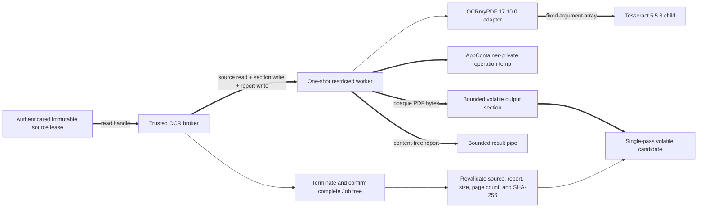
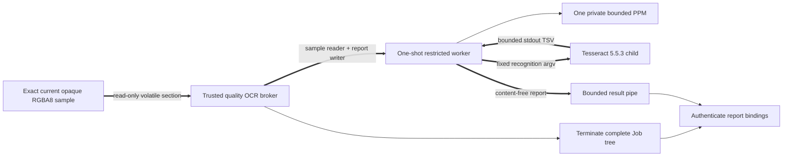

# Bounded local OCR worker contract

- Status: PWS-0204 implementation contract
- Task: PWS-0204
- Extension: PWS-0206 [verified searchable mixed-document output](searchable-mixed-output.md)
- Review extension: PWS-0207 [advisory page-quality review](quality-review.md)
- Decisions: PWS-D009, PWS-D012, PWS-D013, PWS-D016, PWS-D027, PWS-D034,
  PWS-D036, PWS-D038
- Worker lifecycle: [Restricted worker lifecycle contract](worker-lifecycle.md)
- Trust flow: [DF-OCR](../security/data-flows.md#df-ocr--local-cleanup-and-recognition)
- Resource policy: [Low-resource engineering policy](../performance/LOW_RESOURCE_POLICY.md)

## Scope and current claim

PWS-0204 admits one local, cancelable `ocr.process` version 1 operation for an authenticated
immutable PDF, JPEG, or PNG source. OCRmyPDF 17.10.0 orchestrates the operation inside the
restricted Python worker, and the only admitted child executable is Tesseract 5.5.3. The worker
has no network capability, and the OCR operation receives only three operation-specific reduced
handles after the fixed worker bootstrap.

A successful operation returns a single-pass view of an opaque PDF candidate held in a bounded,
broker-owned volatile section. That candidate is not an OCR-text result, case artifact, manifest
operation, verified export, or promise of searchability. It is never published automatically.
PWS-0206 reuses the admitted worker-side OCRmyPDF/Tesseract adapter and exact engine profile for one
private base page at a time through the additive `pdf.export.searchable` version 1 path. It does
not invoke `ocr.process` or consume this broker-owned section; it independently reopens, renders,
and checks its private page result before publication. `ocr.process` version 1 and its report
meaning remain unchanged.

PWS-0204 does not expose recognized text, word counts, or confidence values. PWS-0207 adds the
separate `ocr.review` version-1 operation for the exact current bounded quality raster; it does not
change `ocr.process` or infer confidence from OCR/searchable-PDF success. The review worker
privately inspects bounded Tesseract stdout TSV, discards recognized bytes and geometry, and emits
only a page-correlated terminal state, word count, and integer mean confidence. The organizer
presents any resulting finding as **Needs review**; it cannot mark a checklist requirement
complete.

## Trust and authority flow



Text alternative: the trusted broker authenticates one immutable source and transfers only a
reduced source reader, a bounded output-section writer, and a bounded report-pipe writer into a
fresh worker. OCRmyPDF operates in that worker and can start only the exact Tesseract child.
Private intermediates stay beneath the AppContainer operation root. The broker terminates the
complete Job tree, revalidates the retained source and correlated report, authenticates every
claimed output byte, and only then exposes a volatile single-pass candidate.

The worker never receives a case path, case-directory ACL, manifest, journal, history, cache,
persistent staging file, external destination, or publication authority. A case UUID or source
UUID is correlation data, never filesystem authority.

### PWS-0207 quality-review authority



The additive `ocr.review` contract has no protocol input object or source handle. The trusted
broker copies only the already validated at-most-256-by-256 current sample into an anonymous
pagefile-backed section and duplicates read-only section and write-only result-pipe rights into a
fresh worker. That worker writes one private random PPM, performs one recognition invocation, and
returns no protocol output object. After the complete Job tree terminates, the broker reads the
canonical report and validates operation, case, manifest revision, page, sample/presentation
digests, selected language/profile, status, count, confidence, and engine version. It exposes no
section, raster, path, TSV, or OCR text to the application.

## Layer and component ownership

| Component | Responsibility | Boundary rule |
|---|---|---|
| `domain.ocr` | Path-free request, progress, report, candidate, profile, and closed error contracts | Standard-library-only; no OCRmyPDF, Tesseract, worker, storage, PDF, imaging, or UI dependency |
| `worker.ocr_broker` | Authenticate the source lease, broker exact handles, coordinate one-shot lifecycle, validate the report and volatile bytes | Trusted GUI-process composition; structural source/client ports only; no OCR library type or source path |
| `worker.ocr_operation` | Adopt handles, copy and hash the source, invoke the adapter, verify the private PDF, and write a correlated report/reference | Restricted host-side operation; no storage or UI dependency |
| `ocr.ocrmypdf_adapter` | Run the fixed OCRmyPDF profile, provide the allowlisted Tesseract plugin, report progress, monitor private temp, and request candidate verification | Worker-only engine boundary; third-party objects and exceptions never cross it |
| `ocr.tesseract_runner` | Start, monitor, cancel, and terminate the exact executable; bound and discard tool output | Sole OCR subprocess site; absolute executable, array arguments, `shell=False`, fixed cwd, and minimal environment |
| `pdf.ocr_candidate_verifier` | Strictly reopen one private OCR PDF with pikepdf and return only a positive page count | Narrow worker-side PDF seam; no recovery, encrypted candidate, third-party object, or raw exception crosses |
| `worker.client.tesseract_runtime` | Authenticate the packaged manifest and exact runtime file closure before launch authority is granted | Standard-library-only launcher-side admission; no runtime discovery through `PATH`, registry, current directory, or user profile |
| `app.ocr_languages` | Present path-free local availability and retain one closed language-set selection | Local-only discovery; no source paths, download action, or arbitrary engine expression |
| `worker.ocr_composition` | Create the OCR-only launcher/client/broker and share the application heavy-operation gate | Exactly one worker plus at most one active child and one heavy document operation |
| `domain.quality_ocr_review` | Define the bounded sample request, canonical content-free report, terminal states, and closed failures | Standard-library-only; pixels/digests are redacted from representations and no recognized text field exists |
| `app.quality_ocr_review` | Select the authenticated process-session language set and translate one exact worker report into an analyzer fact | Expected engine/language unavailability becomes a failed review fact; safety, infrastructure, cancellation, deadline, and result-integrity failures remain terminal |
| `worker.quality_ocr_review_broker` | Own the volatile sample section/result pipe, one-shot worker lifecycle, resource gate, and complete report correlation | Terminates the worker before report read; no source, case path, or persistent-writer authority |
| `worker.quality_ocr_review_operation` | Validate/adopt the sample handle, write/remove private PPM, run bounded Tesseract TSV recognition, and emit the canonical report | Worker-only numeric aggregation; recognized bytes/geometry and stderr are discarded |
| `worker.quality_ocr_review_composition` | Retain capability-scoped launch configuration while creating one fresh worker generation per page | Same authenticated runtime authority and application heavy-operation gate; at most worker plus one child concurrently |

Package initializers remain passive. UI/application code does not import OCRmyPDF, Tesseract,
`pikepdf`, or an OCR adapter. The desktop composition root may expose only the typed broker port.

## Exact engine and semantic profile

Capability registration succeeds only when all of the following are present and exact:

- OCRmyPDF distribution and module version `17.10.0`;
- Tesseract version `5.5.3` at the admitted absolute executable;
- the built-in `eng` language in the admitted tessdata directory; and
- the fixed engine-profile SHA-256 computed from both versions and the semantic settings below.

The closed language-set tokens are `latin-default-v1` (`eng`), `german-fast-v1` (`deu`), and
`english-german-fast-v1` (`eng`, then `deu`). They are not filenames, command fragments, or
caller-supplied Tesseract expressions. PWS-0205 discovery reports only authenticated local facts;
selection cannot make a missing pack available. A request that selects `deu` is preflighted against
the same runtime admission and fails before source authority is borrowed when that optional model
is absent or invalid.

The desktop root captures the configured executable and tessdata paths once and constructs the
process-session language manager from that same binding. OCR and searchable-export compositions
carry only a path-free authority digest back to their service builders; a service refuses a worker
composition from a different runtime binding. When a caller omits a language ID or export profile,
the manager atomically re-admits the captured local runtime and returns the exact current session
selection, which is then carried explicitly through the request, plan, wire payload, fingerprint,
and report. An explicit ID/profile remains deterministic and is preflighted exactly. Selection is
not persisted across application restarts, and no unavailable selection falls back to English.

The optional page-quality composition is deliberately lazy. Backend startup creates only its typed
processor seam; it performs no optional OCR runtime admission or worker launch. On the first
explicit quality review with an authenticated available selection, the backend owner thread checks
cancellation/deadline, constructs and adopts the capability-scoped composition, and checks both
again before launching a page worker. Runtime inventory/admission is fixed-work and bounded in
scope but has no elapsed-time guarantee, so these checks do not turn it into a promised
interruptible timed step. Only an expected missing/unavailable local runtime state is latched for
that process session to avoid repeating expensive work per page or review. Authority, isolation,
launch, process, transport, protocol, resource-limit, cleanup, and malformed-result failures remain
terminal. Restart creates a fresh authority and admission attempt; saving a different session
language selection clears accepted quality findings and returns the UI to **Not checked**.

The `searchable-pdf-v1` engine profile is:

| Setting | Exact value |
|---|---|
| Image input resolution | `image_dpi=300` |
| Output type | standard PDF (`output_type="pdf"`), not PDF/A |
| OCR workers | `jobs=1`, `use_threads=True` |
| Existing-text handling | `mode="skip"` |
| Optimization | `optimize=0` |
| OCR text renderer | `pdf_renderer="fpdf2"` |
| Page rasterizer | `rasterizer="pypdfium"` |
| Scan cleanup inside OCRmyPDF | rotation, background removal, deskew, clean, and final clean all disabled |
| Per-child OpenMP limit | `OMP_THREAD_LIMIT=1` |

The profile digest changes when one of these semantic settings or either engine version changes.
Such a change requires reviewed dependency/profile evidence; a version-looking string alone is
not sufficient.

The separate page-quality OCR profile token is `quality-ocr-review-v1`. It converts only the exact
opaque current sample to a private binary PPM and invokes the admitted executable with this closed
shape:

```text
tesseract <private-random-input.ppm> stdout -l <closed-language-codes> --psm 6 tsv
```

The private input path is generated by the worker and cannot contain a source filename or user
value. `<closed-language-codes>` is derived only from the three language-set tokens above, never
copied from caller text. One successful TSV parse counts only word-level rows with a nonnegative
numeric confidence and a bounded non-whitespace final field. It never decodes or returns that
field. Confidence is converted to integer milli-units without floating point; zero accepted words
is `no_text`, while `succeeded` requires at least one word and a mean confidence. This profile is a
review heuristic over a resampled 256-pixel presentation, not an OCR-accuracy claim.

OCRmyPDF plugin discovery is allowlist-only. It loads the fixed concurrency, default-filter,
optimization, and pypdfium built-ins plus PaperWorkShell's Tesseract/progress plugin. It does not
scan installed entry points, register Ghostscript execution, or inherit arbitrary user plugins.
The OCR adapter calls only the narrow worker-side `pdf.ocr_candidate_verifier` seam, which reopens
without recovery, rejects encryption, and returns a page count or closed failure. No pikepdf object
or broader PDF capability crosses it.

## Executable and runtime admission

The OCR-specific Windows composition uses a Job Object with an active-process limit of two: one
Python worker and at most one Tesseract child. `jobs=1` prevents per-page process fan-out, and the
application-wide heavy-operation coordinator permits only one heavy document operation at a time.
The child remains in the same no-breakaway Job and zero-capability AppContainer, so worker egress,
memory, CPU, termination, and descendant controls apply to it.

The packaged Tesseract base manifest names exactly 39 reviewed files, including the executable,
native DLL closure, and `share/tessdata/eng.traineddata`. The separately fingerprinted optional-pack
catalog admits only `share/tessdata/deu.traineddata`, with exact size and SHA-256. Runtime admission
requires the packaged manifest and catalog bytes, exact layout, exact size and SHA-256 for every
present file, single-link regular files with only their unnamed data stream, stream-free
directories, no missing required entries, and no unlisted entries. Before any runtime path is
opened or enumerated, both configured paths must form the exact layout on one Windows-presented,
mount-manager-registered `DRIVE_FIXED` volume whose drive and volume-GUID names map to the same
`\\Device\\HarddiskVolumeN`. UNC/device spellings, network-drive mappings, unregistered DOS aliases,
non-NTFS/ReFS volumes, volumes without persistent ACLs, reparse ancestors, and offline/recall
attributes fail closed. This OS-visible check does not attest the physical medium or lower-layer
storage transport; iSCSI-, SAN-, or VHD/VHDX-backed volumes can satisfy it. A missing
optional file is simply unavailable; a present but changed file invalidates the runtime. Admission
is repeated before the launcher grants AppContainer access, so failure occurs before process
creation. Version and language probes use the same boundary before the host advertises
`ocr.process` or `ocr.review`; a fresh `ocr.review` worker repeats those fixed probes before its
one recognition invocation.

The runtime authenticates staged bytes, not upstream distribution signatures. Packaging must
validate each detached MSYS2 signature against the reviewed signer key before extraction. Neither
the application nor worker downloads packs. Close and restart PaperWorkShell after an offline pack
change; exact release staging path, elevation, removal, and notices remain PWS-0801/PWS-0802 work.
The source-build environment-path seam is capability-only: although admission is repeated before
launch, the launcher does not retain each model file handle through the native child's later open.
PWS-0801/PWS-0802 must therefore stage the exact closure in an installer-protected, read-only
location and prove its ACL/repair/update behavior before any packaged-release claim.

Tesseract launch uses:

- the admitted absolute executable as both `executable` and argument zero;
- a structured argument sequence constructed by the private OCR plugin;
- `shell=False`, `close_fds=True`, a no-window process group, and the executable directory as the
  fixed working directory;
- only `SYSTEMROOT`/`WINDIR` when available plus private `TEMP`/`TMP`, the admitted
  `TESSDATA_PREFIX`, and `OMP_THREAD_LIMIT=1`; and
- no `PATH`, `PATHEXT`, `COMSPEC`, proxy, Python, cloud-credential, filename, OCR-text, or user
  profile value.

The worker installs a process-creation audit hook before any optional engine is loaded. It rejects
shell/spawn APIs and any `subprocess.Popen` event whose executable, argument zero, working
directory, or child environment differs from the fixed launch authority. Tool stdout and stderr
are drained separately under one shared live byte budget per invocation. Version/language probe
stdout is retained only within its bound. Ordinary recognition output is discarded. The sole additional retained
shape is `ocr.review` TSV stdout for an exact private-PPM/closed-language/`--psm 6` invocation;
stderr remains discarded, cannot contaminate the strict TSV parser, and neither stream enters an
error or log.

Before that immutable hook is installed, the host seeds Python's platform cache with only the
already-proven Windows OS family. This prevents the standard library from attempting its ambient
`cmd.exe /c ver` fallback while the pinned PDFium rasterizer imports; no command output or broader
host-platform discovery is admitted.

The repository dependency inventory and runtime-closure manifest provide current admission and
redistribution evidence for PWS-0204. PWS-0801 still owns the release-grade lock comparison,
complete packaged-content/SBOM match, final notice bundle, and release-input hash verification.

## Private storage and resource bounds

Before launch, the broker rejects a request unless its page count fits policy and the complete
source plus maximum candidate size fit the operation temporary-storage limit. Production
composition derives memory, CPU, page, pixel, temporary-storage, and output limits from the
central versioned `ResourcePolicy`; it does not create an unbounded OCR profile. OCR has a
300-second wall deadline, while the direct Tesseract call has a shorter bounded timeout.

The worker then:

1. checks that its private volume can satisfy the complete operation temp limit plus the common
   safety reserve;
2. creates and pins one random operation directory beneath its authenticated AppContainer-private
   `TEMP` root;
3. copies exactly the expected source bytes while recomputing SHA-256, then closes the case-source
   handle before native parsing;
4. forces OCRmyPDF and Python temporary files beneath that operation directory and binds
   OCRmyPDF's otherwise required home lookup to the same private root;
5. samples the complete private tree while OCR runs, fails on excess bytes, reparse/special
   entries, or inventory uncertainty, and performs strict stage-boundary inventories; and
6. closes and removes the complete pinned operation tree on success, cancellation, timeout, and
   failure; cleanup uncertainty becomes an authoritative failure.

Python 3.14 gives a Windows directory created with mode `0o700` an explicit ACL that is unsuitable
for later AppContainer access. OCRmyPDF 17.10 imports `mkdtemp` directly for its work folder, so the
version-bound adapter temporarily replaces that exact callable, plus `TemporaryDirectory`, with a
closed inherited-ACL factory beneath the authenticated operation root. The adapter rejects API or
argument drift, restores both callables in `finally`, and leaves final no-follow deletion to the
pinned operation owner. This compatibility seam does not permit an ambient temp path or plugin.

This is a prospective and stage-verified operation bound, not a claim that the canonical resource
report continuously measures every worker-private byte. The report limitation is documented in
the low-resource policy. A limit failure produces no candidate and cannot change an original or
manifest.

`ocr.review` has a separate, smaller private-storage contract. Production accepts one page,
at most 65,536 pixels and a 256-pixel edge, at most 4,096 row-padding bytes, a 1 MiB shared
Tesseract-output budget, a 4 MiB temporary-storage budget, a 60-second operation wall limit, and a
45-second CPU limit capped again by the selected central `ResourcePolicy`. Before Tesseract runs,
the worker checks private-temp capacity for the complete requested limit, writes exactly one random
PPM beneath the authenticated private temp root, and validates opaque alpha while packing RGBA to
RGB. TSV stays in bounded memory; no TSV file is created. Success, output limit, low-space/capacity
refusal, cancellation, timeout, engine failure, and malformed output all take the PPM cleanup path;
cleanup uncertainty is terminal and cannot publish a report. Focused evidence requires no runner
call after capacity refusal, no leftover artifact for those injected failure paths, and a fresh
successful retry after the refusal/output-limit path.

## Progress, cancellation, and terminal behavior

Progress is a closed, content-free record containing only the operation UUID, phase, completed
page count, and total page count. The vocabulary is `preparing`, `recognizing`, `finalizing`,
`validating`, and `complete`; the current broker coalesces worker-finalization updates into its
numeric recognizing stream and exposes preparing, recognizing, validating, and complete. Page
counts are monotonic and bounded by the authenticated request. No OCR text, filename, path, digest,
tool output, or third-party message is a progress value.

Cancellation and deadlines are checked before source work, while copying, at OCRmyPDF progress
updates, while waiting for Tesseract, while monitoring temp, while copying the candidate, and while
the broker validates output. A direct-child cancellation or timeout first terminates Tesseract,
then escalates to a kill when the bounded grace period expires. The broker always terminates the
complete one-shot worker Job before it reads the
report or output section and before it releases source authority. A worker crash, malformed
message/report, timeout, missing engine/language, cancellation-cleanup fault, or unconfirmed Job
termination yields one stable sanitized failure and no candidate.

For `ocr.review`, worker RPC progress remains only `processing/pages` with an exact total of one;
the application exposes a content-free OCR-reviewing phase within the whole saved-revision review.
Cancellation/deadline checks surround lazy construction, heavy-gate acquisition, worker ready,
operation/result polling, TSV row parsing, private input writing/cleanup, report read, and final
binding validation. The broker terminates the worker before report read on every page. Expected
local engine/runtime absence, an unavailable selected language, or an engine-reported recognition
failure becomes a failed OCR-review fact. Authority, isolation, launch, process, transport,
protocol, cancellation, timeout, resource-limit, cleanup, malformed-output, and correlation
failures remain terminal and cannot be presented as no signals found.

## Candidate validation and lifetime

Inside the worker, success requires a regular non-reparse file beneath private temp,
the `%PDF-` header, an exact byte limit, SHA-256, and a no-recovery `pikepdf` reopen with the expected
page count. The worker copies only those exact bytes into the fixed output section and emits a
bounded canonical report containing correlation IDs, source kind, page counts, language/profile
tokens, exact engine versions/profile digest, candidate size, and candidate digest.

After confirmed Job-tree termination, the broker reauthenticates the retained source, decodes the
closed report, checks every request/operation/source/output/profile/version/size/digest binding,
and independently hashes the claimed section bytes. A caller may then stream the candidate once
inside its context lifetime. Closing the candidate releases the volatile section. No PWS-0204
path writes it to case storage or an external destination.

The mixed-output adapter has a separate page-scoped lifetime: it creates one private base/result
pair, selects the verified result or retains the base, and removes that authenticated page
directory before processing another page. It cannot retain a packet-sized collection of OCR
results, treat an engine's aggregate processed-page count as per-page evidence, or infer text
presence from OCR engine success. The separately verified page outcome is defined by
[Verified searchable mixed-document output](searchable-mixed-output.md).

Routine representations, errors, progress, and logs may contain only closed codes, internal IDs,
versions, counts, and numeric resource facts. They never contain OCR/document text, filenames,
full paths, source/candidate digests, tool output, metadata, page images, names, or addresses.

## Signed PDFs and explicit deferrals

PWS-0204 accepts a PDF only when upstream structural inspection reports `NONE_DETECTED` signature
markers and confirmed unencrypted state. Marker-present, unknown-signature, encrypted, and
unknown-encryption states fail before worker launch. `NONE_DETECTED` is a conservative structural
fact, not cryptographic signature validation.

This fail-closed behavior deliberately provides no “continue anyway” path. PWS-0206 defines the
page-local marker-present/unknown fallback, keeps blocked pages visually retained, and requires an
**unsigned derivative** result label whenever such a source participates in its output. PWS-0208
owns the signed-source policy service and explicit derivative warning/confirmation, plus measured
incremental workload evidence.
PWS-0209 retains the complete mixed-document, accessibility, cancellation, signed-source, and
constrained-resource gate.

Additional deferrals are:

- PWS-0801: final packaged dependency/SBOM/license-notice and release-input verification; and
- PWS-0802/PWS-0803/PWS-0807: packaged-build installation, signing, and release-matrix evidence.
