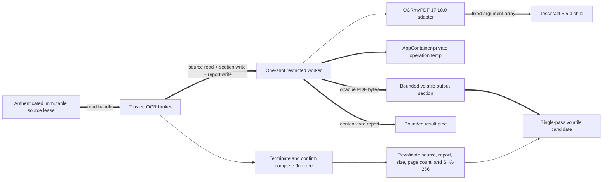

# Bounded local OCR worker contract

- Status: PWS-0204 implementation contract
- Task: PWS-0204
- Decisions: PWS-D009, PWS-D012, PWS-D013, PWS-D016, PWS-D027, PWS-D034,
  PWS-D036, PWS-D038
- Worker lifecycle: [Restricted worker lifecycle contract](worker-lifecycle.md)
- Trust flow: [DF-OCR](../security/data-flows.md#df-ocr--local-cleanup-and-recognition)
- Resource policy: [Low-resource engineering policy](../performance/LOW_RESOURCE_POLICY.md)

## Scope and current claim

PWS-0204 admits one local, cancelable `ocr.process` version 1 operation for an authenticated
immutable PDF, JPEG, or PNG source. OCRmyPDF 17.10.0 orchestrates the operation inside the
restricted Python worker, and the only admitted child executable is Tesseract 5.5.3. The worker
has no network capability, and the OCR operation receives only three operation-specific reduced
handles after the fixed worker bootstrap.

A successful operation returns a single-pass view of an opaque PDF candidate held in a bounded,
broker-owned volatile section. That candidate is not an OCR-text result, case artifact, manifest
operation, verified export, or promise of searchability. It is never published automatically.
PWS-0206 owns page eligibility, mixed born-digital/scanned output, searchability verification,
reopen/render verification, and authoritative derivative publication.

PWS-0204 does not expose recognized text or confidence values. Later review findings must use
“Needs review” and remain subject to user confirmation; they may not mark a checklist requirement
complete.

## Trust and authority flow

Text alternative: the trusted broker authenticates one immutable source and transfers only a
reduced source reader, a bounded output-section writer, and a bounded report-pipe writer into a
fresh worker. OCRmyPDF operates in that worker and can start only the exact Tesseract child.
Private intermediates stay beneath the AppContainer operation root. The broker terminates the
complete Job tree, revalidates the retained source and correlated report, authenticates every
claimed output byte, and only then exposes a volatile single-pass candidate.

The worker never receives a case path, case-directory ACL, manifest, journal, history, cache,
persistent staging file, external destination, or publication authority. A case UUID or source
UUID is correlation data, never filesystem authority.

## Layer and component ownership

| Component | Responsibility | Boundary rule |
|---|---|---|
| `domain.ocr` | Path-free request, progress, report, candidate, profile, and closed error contracts | Standard-library-only; no OCRmyPDF, Tesseract, worker, storage, PDF, imaging, or UI dependency |
| `worker.ocr_broker` | Authenticate the source lease, broker exact handles, coordinate one-shot lifecycle, validate the report and volatile bytes | Trusted GUI-process composition; structural source/client ports only; no OCR library type or source path |
| `worker.ocr_operation` | Adopt handles, copy and hash the source, invoke the adapter, verify the private PDF, and write a correlated report/reference | Restricted host-side operation; no storage or UI dependency |
| `ocr.ocrmypdf_adapter` | Run the fixed OCRmyPDF profile, provide the allowlisted Tesseract plugin, report progress, monitor private temp, and request candidate verification | Worker-only engine boundary; third-party objects and exceptions never cross it |
| `ocr.tesseract_runner` | Start, monitor, cancel, and terminate the exact executable; bound and discard tool output | Sole OCR subprocess site; absolute executable, array arguments, `shell=False`, fixed cwd, and minimal environment |
| `pdf.ocr_candidate_verifier` | Strictly reopen one private OCR PDF with pikepdf and return only a positive page count | Narrow worker-side PDF seam; no recovery, encrypted candidate, third-party object, or raw exception crosses |
| `worker.client.tesseract_runtime` | Authenticate the packaged manifest and exact runtime file closure before launch authority is granted | Standard-library-only launcher-side admission; no runtime discovery through `PATH`, registry, current directory, or user profile |
| `worker.ocr_composition` | Create the OCR-only launcher/client/broker and share the application heavy-operation gate | Exactly one worker plus at most one active child and one heavy document operation |

Package initializers remain passive. UI/application code does not import OCRmyPDF, Tesseract,
`pikepdf`, or an OCR adapter. The desktop composition root may expose only the typed broker port.

## Exact engine and semantic profile

Capability registration succeeds only when all of the following are present and exact:

- OCRmyPDF distribution and module version `17.10.0`;
- Tesseract version `5.5.3` at the admitted absolute executable;
- the built-in `eng` language in the admitted tessdata directory; and
- the fixed engine-profile SHA-256 computed from both versions and the semantic settings below.

The initial language-set token is `latin-default-v1`, which resolves internally to `eng`. It is
not a filename, command fragment, or arbitrary Tesseract language expression. PWS-0205 owns
additional offline language-pack discovery, selection, verification, and remediation.

The `searchable-pdf-v1` engine profile is:

| Setting | Exact value |
|---|---|
| Image input resolution | `image_dpi=300` |
| Output type | standard PDF (`output_type="pdf"`), not PDF/A |
| OCR workers | `jobs=1`, `use_threads=True` |
| Existing-text handling | `mode="skip"` |
| Optimization | `optimize=0` |
| OCR text renderer | `pdf_renderer="fpdf2"` |
| Page rasterizer | `rasterizer="pypdfium"` |
| Scan cleanup inside OCRmyPDF | rotation, background removal, deskew, clean, and final clean all disabled |
| Per-child OpenMP limit | `OMP_THREAD_LIMIT=1` |

The profile digest changes when one of these semantic settings or either engine version changes.
Such a change requires reviewed dependency/profile evidence; a version-looking string alone is
not sufficient.

OCRmyPDF plugin discovery is allowlist-only. It loads the fixed concurrency, default-filter,
optimization, and pypdfium built-ins plus PaperWorkShell's Tesseract/progress plugin. It does not
scan installed entry points, register Ghostscript execution, or inherit arbitrary user plugins.
The OCR adapter calls only the narrow worker-side `pdf.ocr_candidate_verifier` seam, which reopens
without recovery, rejects encryption, and returns a page count or closed failure. No pikepdf object
or broader PDF capability crosses it.

## Executable and runtime admission

The OCR-specific Windows composition uses a Job Object with an active-process limit of two: one
Python worker and at most one Tesseract child. `jobs=1` prevents per-page process fan-out, and the
application-wide heavy-operation coordinator permits only one heavy document operation at a time.
The child remains in the same no-breakaway Job and zero-capability AppContainer, so worker egress,
memory, CPU, termination, and descendant controls apply to it.

The packaged Tesseract runtime manifest names exactly 39 reviewed files, including the executable,
native DLL closure, and `share/tessdata/eng.traineddata`. Runtime admission requires the packaged
manifest's fixed SHA-256, exact layout, exact size and SHA-256 for every file, single-link regular
files, non-reparse directories, no missing entries, and no unlisted entries. Admission is repeated
immediately before the launcher grants the AppContainer access; a changed closure fails before
process creation. Version and language probes use the same executable boundary before the host
advertises `ocr.process`.

Tesseract launch uses:

- the admitted absolute executable as both `executable` and argument zero;
- a structured argument sequence constructed by the private OCR plugin;
- `shell=False`, `close_fds=True`, a no-window process group, and the executable directory as the
  fixed working directory;
- only `SYSTEMROOT`/`WINDIR` when available plus private `TEMP`/`TMP`, the admitted
  `TESSDATA_PREFIX`, and `OMP_THREAD_LIMIT=1`; and
- no `PATH`, `PATHEXT`, `COMSPEC`, proxy, Python, cloud-credential, filename, OCR-text, or user
  profile value.

The worker installs a process-creation audit hook before any optional engine is loaded. It rejects
shell/spawn APIs and any `subprocess.Popen` event whose executable, argument zero, working
directory, or child environment differs from the fixed launch authority. Tool stdout and stderr
are merged into one byte-counted stream, retained only for bounded version/language probes, and
otherwise discarded.

Before that immutable hook is installed, the host seeds Python's platform cache with only the
already-proven Windows OS family. This prevents the standard library from attempting its ambient
`cmd.exe /c ver` fallback while the pinned PDFium rasterizer imports; no command output or broader
host-platform discovery is admitted.

The repository dependency inventory and runtime-closure manifest provide current admission and
redistribution evidence for PWS-0204. PWS-0801 still owns the release-grade lock comparison,
complete packaged-content/SBOM match, final notice bundle, and release-input hash verification.

## Private storage and resource bounds

Before launch, the broker rejects a request unless its page count fits policy and the complete
source plus maximum candidate size fit the operation temporary-storage limit. Production
composition derives memory, CPU, page, pixel, temporary-storage, and output limits from the
central versioned `ResourcePolicy`; it does not create an unbounded OCR profile. OCR has a
300-second wall deadline, while the direct Tesseract call has a shorter bounded timeout.

The worker then:

1. checks that its private volume can satisfy the complete operation temp limit plus the common
   safety reserve;
2. creates and pins one random operation directory beneath its authenticated AppContainer-private
   `TEMP` root;
3. copies exactly the expected source bytes while recomputing SHA-256, then closes the case-source
   handle before native parsing;
4. forces OCRmyPDF and Python temporary files beneath that operation directory and binds
   OCRmyPDF's otherwise required home lookup to the same private root;
5. samples the complete private tree while OCR runs, fails on excess bytes, reparse/special
   entries, or inventory uncertainty, and performs strict stage-boundary inventories; and
6. closes and removes the complete pinned operation tree on success, cancellation, timeout, and
   failure; cleanup uncertainty becomes an authoritative failure.

Python 3.14 gives a Windows directory created with mode `0o700` an explicit ACL that is unsuitable
for later AppContainer access. OCRmyPDF 17.10 imports `mkdtemp` directly for its work folder, so the
version-bound adapter temporarily replaces that exact callable, plus `TemporaryDirectory`, with a
closed inherited-ACL factory beneath the authenticated operation root. The adapter rejects API or
argument drift, restores both callables in `finally`, and leaves final no-follow deletion to the
pinned operation owner. This compatibility seam does not permit an ambient temp path or plugin.

This is a prospective and stage-verified operation bound, not a claim that the canonical resource
report continuously measures every worker-private byte. The report limitation is documented in
the low-resource policy. A limit failure produces no candidate and cannot change an original or
manifest.

## Progress, cancellation, and terminal behavior

Progress is a closed, content-free record containing only the operation UUID, phase, completed
page count, and total page count. The vocabulary is `preparing`, `recognizing`, `finalizing`,
`validating`, and `complete`; the current broker coalesces worker-finalization updates into its
numeric recognizing stream and exposes preparing, recognizing, validating, and complete. Page
counts are monotonic and bounded by the authenticated request. No OCR text, filename, path, digest,
tool output, or third-party message is a progress value.

Cancellation and deadlines are checked before source work, while copying, at OCRmyPDF progress
updates, while waiting for Tesseract, while monitoring temp, while copying the candidate, and while
the broker validates output. A direct-child cancellation or timeout first terminates Tesseract,
then escalates to a kill when the bounded grace period expires. The broker always terminates the
complete one-shot worker Job before it reads the
report or output section and before it releases source authority. A worker crash, malformed
message/report, timeout, missing engine/language, cancellation-cleanup fault, or unconfirmed Job
termination yields one stable sanitized failure and no candidate.

## Candidate validation and lifetime

Inside the worker, success requires a regular non-reparse file beneath private temp,
the `%PDF-` header, an exact byte limit, SHA-256, and a no-recovery `pikepdf` reopen with the expected
page count. The worker copies only those exact bytes into the fixed output section and emits a
bounded canonical report containing correlation IDs, source kind, page counts, language/profile
tokens, exact engine versions/profile digest, candidate size, and candidate digest.

After confirmed Job-tree termination, the broker reauthenticates the retained source, decodes the
closed report, checks every request/operation/source/output/profile/version/size/digest binding,
and independently hashes the claimed section bytes. A caller may then stream the candidate once
inside its context lifetime. Closing the candidate releases the volatile section. No PWS-0204
path writes it to case storage or an external destination.

Routine representations, errors, progress, and logs may contain only closed codes, internal IDs,
versions, counts, and numeric resource facts. They never contain OCR/document text, filenames,
full paths, source/candidate digests, tool output, metadata, page images, names, or addresses.

## Signed PDFs and explicit deferrals

PWS-0204 accepts a PDF only when upstream structural inspection reports `NONE_DETECTED` signature
markers and confirmed unencrypted state. Marker-present, unknown-signature, encrypted, and
unknown-encryption states fail before worker launch. `NONE_DETECTED` is a conservative structural
fact, not cryptographic signature validation.

This fail-closed behavior deliberately provides no “continue anyway” path. PWS-0206 owns verified
searchable derivative construction and PWS-0208 owns the signed-source policy service, explicit
derivative warning/confirmation, unsigned-derivative labeling, and incremental workload evidence.
PWS-0209 retains the complete mixed-document, accessibility, cancellation, signed-source, and
constrained-resource gate.

Additional deferrals are:

- PWS-0205: offline installation and selection of additional checksum-tracked language packs;
- PWS-0207: OCR confidence and scan-quality review findings;
- PWS-0801: final packaged dependency/SBOM/license-notice and release-input verification; and
- PWS-0803/PWS-0807: packaged-build signing, installer, and release-matrix evidence.
