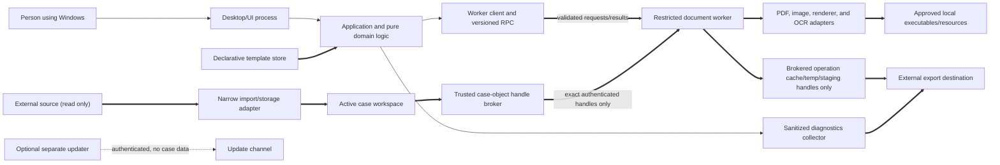
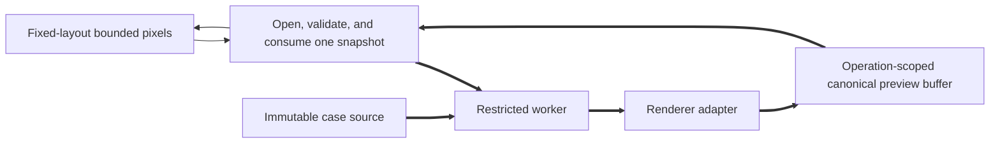
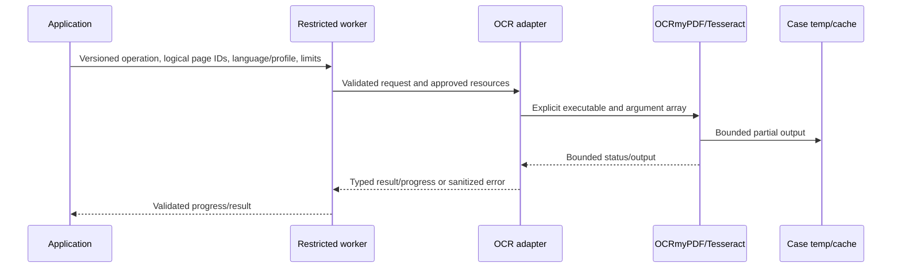
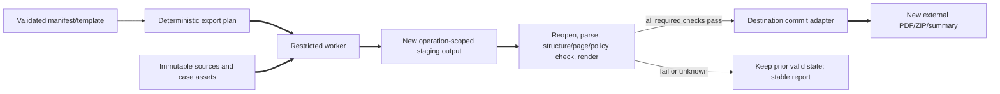
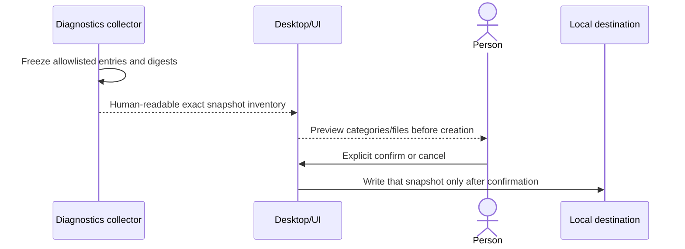
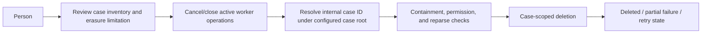

# PaperWorkShell data flows and trust-boundary crossings

- Status: Binding foundation model
- Task: PWS-0004
- Companion: [foundation threat model](threat-model.md)

## Reading the diagrams

Thin arrows carry control or typed metadata that is either validated or awaiting validation at the
receiving boundary. Thick arrows represent document-derived bytes that must never be written to
routine logs. Dashed arrows are optional future behavior.
The prose below every diagram is authoritative and provides an accessible text alternative.

Component labels describe ownership, not a promise that every component already exists. Future
tasks must preserve the trust-boundary rules rather than copying these labels into one process.

## System context



Text alternative: the person interacts only with the desktop process. Application/domain logic
orchestrates a validated worker client. Full document processing occurs in a restricted worker
through admitted adapters and local tools. External sources enter through a narrow read-only
import/storage path and become random case-scoped files before complex parsing. A trusted broker
must authenticate and transfer an exact least-privilege handle before a worker operation can touch
one of those objects; logical case binding is not path access. Verified output moves from case
staging to a user-selected external destination. Templates enter as validated data. Diagnostics
use a separate allowlisted flow. A future updater is separate from document processing and sends
no case data. The current `protocol.noop` worker receives no document handles.

## Boundary inventory

| Boundary | Producer → consumer | Data crossing | Required check before consumption |
|---|---|---|---|
| TB-01 | Person/Windows shell → UI | Paths, typed values, drag/clipboard data, confirmation | Length/type/state validation; no trust from extension or familiar display |
| TB-02 | Application → worker | Versioned request, per-launch capability, internal IDs, logical case-object references, limits | Fresh AppContainer/job generation; explicit inherited pipes and fixed bootstrap grant; bind worker, case, operation, sequence, and request; schema/type/version/size/state validation; replay rejection |
| TB-02 | Worker → application | Progress, typed result, capability, stable error | Validate explicit transport/session binding, envelope, IDs, sequence/state transition, size, references, counts, and sanitized parameters |
| TB-03 | Trusted broker → worker | Exact opened read-only input or operation-scoped cache/temp/staging handle | Authenticate file identity, case/area/operation scope, access, containment, links/reparse/hardlink/ADS state, size/digest, quota, and lifetime before transfer; broker-only authoritative publication |
| TB-04 | Worker adapter → local tool/resource | Executable, arguments, input/output handles, controlled environment/search paths | Approved path/version/identity, fixed working directory, no shell, bounded I/O/time/resources/descendants, network denial |
| TB-05 | Import adapter → external source | One read-only handle and bounded byte stream | Classify local/device/network location before open; supported regular-file identity; never request write access |
| TB-06 | Verified staging → export destination | Exact verified PDF/ZIP/summary bytes, size/digest, and safe name | Classify destination; reject original/prior-output aliases; destination-local temporary file, collision policy, terminal identity/digest recheck, per-artifact atomic commit |
| TB-07 | Diagnostics → bundle destination | Frozen allowlisted entry snapshot and generated safe files | Preview and confirm the exact snapshot/digests; no recollection; prohibited-content scan; local write only |
| TB-08 | Template store → loader | Template bytes, provenance, and trust state | Size, schema, version, checksum/signature when supported, expiry; data only; inert provenance URLs are never dereferenced |
| TB-09 | Updater ↔ network/install | Version/channel metadata and package | No case fields; authenticated metadata/package; rollback/expiry/channel policy |
| TB-10 | Case storage → local account/session | Case files and lock/retention state | Restrictive permissions, random names, consent/lock/expiry policy |

## DF-WORKER-LIFECYCLE — launch, negotiate, operate, stop, and restart

```mermaid
sequenceDiagram
    participant App as Application coordinator
    participant Client as GUI-safe worker client
    participant Win as Trusted Windows launcher
    participant Host as Restricted worker host
    App->>Client: Start with logical case ID and trusted policies
    Client->>Win: Fresh session, worker ID, capability, resource policy
    Win->>Win: Create zero-capability profile, pipes, and Job Object
    Win->>Host: Create suspended with exactly stdin/stdout/bootstrap handles
    Win->>Win: Assign job; write fixed 92-byte grant; resume
    Host->>Host: Validate grant and audit token/job/environment
    Client->>Host: Framed, authenticated session.hello
    Host-->>Client: Validated session.ready
    Client->>Host: One registered operation and explicit limits
    Host-->>Client: Accepted, progress, and one terminal result
    Client->>Host: Optional cooperative cancel or graceful shutdown
    Host-->>Client: Cancel acknowledgement/result or session.closed
    Client->>Win: Timeout, fault, or force-stop terminates retained job tree
    Client->>Win: Restart creates a wholly fresh generation; no replay
```

1. TB-02 launch state is generated by the trusted client, not the worker: a new generation,
   session UUID, worker-instance UUID, case UUID binding, and 256-bit capability.
2. The launcher creates a per-launch AppContainer with no capability SIDs. It temporarily grants
   read/execute only to approved runtime/code roots. Its constructed `LOCALAPPDATA`, `TEMP`, and
   `TMP` point into the ephemeral profile; no user environment or case path is inherited.
3. The child is created suspended with a fixed absolute executable/argument array, no shell, and
   exactly three anonymous-pipe handles. The Job Object is configured/assigned before resume and
   covers memory, CPU, process-count, kill-on-close, and descendant termination policy.
4. Standard error is a one-shot bootstrap reader, not a diagnostic channel. The exact 92-byte
   grant carries only fixed magic/version, three UUID identities, and the capability. RPC on
   standard input/output is independently length-framed to 65,536 payload bytes.
5. The worker fails before `session.ready` unless the grant, AppContainer token, zero capabilities,
   Job membership, minimal environment, protocol binding, and negotiation validate. Malformed,
   replayed, cross-generation, or out-of-order messages fault the generation before dispatch.
6. One coordinator actor on each side owns protocol state. Progress/operation threads report
   bounded events only. A valid terminal result processed before a deadline event wins; a cancel
   acknowledgement is nonterminal. A timeout/fault terminates the complete job tree.
7. A clean shutdown requires correlated `session.closed`. Unexpected EOF/exit becomes a stable
   failure without killing the desktop process or exposing exit/stderr values. Restart creates new
   profile/job/pipes/IDs/capability/sequences and never replays work.
8. The current no-op carries no inputs, outputs, or document handles. Case access remains absent
   until a future trusted broker authenticates and transfers an exact handle out of band.
9. Live evidence must cover real IPv4/IPv6 TCP/UDP denial for worker and descendant, whole-tree
   kill/no-breakaway, exact inherited handles, environment canary absence, path denial, deliberate
   handle success, and profile/grant cleanup. A required skip is not a pass.

Primary threats: TM-001, TM-002, TM-004, TM-008, TM-009, TM-011, TM-012, TM-022, TM-023.

## DF-IMPORT — select, precheck, copy, inspect, and commit source

```mermaid
sequenceDiagram
    actor Person
    participant UI as Desktop/UI
    participant Precheck as Source precheck
    participant Case as Case pending/originals
    participant Inspect as Typed inspection boundary
    participant Broker as Trusted storage broker
    participant Manifest as Manifest transaction
    Person->>UI: Select source path
    UI->>Precheck: Import request, selected path, limits
    Precheck->>Precheck: Canonicalize; open once read-only; bounded framing
    Precheck->>Case: Stream same live handle to random pending file; hash
    Case->>Case: Flush, reopen, verify size/digest/identity
    Precheck->>Precheck: Terminal external-source identity check; close lease
    Precheck-->>Broker: Prepared logical ID and verified byte facts
    Broker->>Inspect: Exact prepared-copy handle and explicit limits
    Inspect-->>Broker: Typed complete metadata or stable error
    Broker->>Case: Publish exact copy as random source ID
    Broker->>Manifest: Append source + complete pages/base/final sequence
    Manifest->>Manifest: Validate target; atomically replace manifest
    Manifest-->>UI: Committed source ID, duplicate advisory, concrete status
```

1. TB-01: the selected path and displayed extension are untrusted.
2. TB-05: the narrow adapter classifies local/device/network policy, rejects unsupported locations,
   and opens a supported regular source exactly once with read-only sharing/identity policy. It may
   perform only bounded signature/size checks while streaming that handle; it never parses full
   PDF/image structure in the UI process.
3. TB-03/TB-05: bytes stream from that same live handle into a random case-scoped pending name while
   SHA-256 is calculated. The pending file is flushed, reauthenticated, and independently read back
   for exact size/digest verification. It remains non-authoritative until the source context exits
   normally and its terminal identity check succeeds. A changing/truncated source, cancellation,
   limit, disk-full, or write failure leaves no valid source record.
4. TB-02/TB-03: complex inspection receives only a logical prepared reference, case/operation
   binding, explicit limits, and an exact broker-authenticated read-only handle. It returns typed
   complete metadata for that copy. PDF `not_checked` values and a missing page count cannot be
   promoted into a source record. The worker cannot write the pending copy, manifest, journal,
   source records, or page records; raw third-party exceptions are discarded.
5. The trusted broker validates the complete metadata and serializes duplicate detection against
   committed SHA-256 values. A match is advisory: each accepted import retains a distinct random
   source ID, immutable case copy, display name, and page identity.
6. The broker publishes the exact verified pending identity beneath `originals/`, then uses the
   PWS-0104 import-only appender to add the source, its complete zero-based page catalogue, and the
   new page IDs to both base and final sequences without an operation. The complete target manifest
   validates before atomic replacement; replacement is the commit point. PWS-0109 later owns the
   general repository and PWS-0110 owns page-operation replay.
7. Cancellation before that commit point retains the previous valid manifest and removes only an
   exact object still owned by the operation. A post-copy/pre-manifest crash can leave a random
   unreferenced case orphan for PWS-0113; it is not a source record. A manifest replacement reported
   as unknown preserves the random source until fresh-open recovery determines whether it is
   referenced. Confirmed commit wins over late cancellation. The external source is never opened
   for writing. Later read-only size, SHA-256, link, stream, reparse, and containment checks detect
   application-model mutation; they do not authenticate against malware able to rewrite both case
   files and manifests.

Primary threats: TM-001, TM-002, TM-003, TM-005, TM-006, TM-007, TM-011, TM-012, TM-022,
TM-023, TM-026.

## DF-PREVIEW — render bounded thumbnails/previews



1. The UI names an internal source/page ID, desired bounded dimensions, and cancellation token; it
   never opens the source document.
2. TB-02/TB-03: the trusted broker resolves the logical ID, authenticates exact read/output
   handles for the case and operation, and only then transfers those handles. The worker applies
   page/pixel/time/memory limits and writes only through the brokered operation-cache handle. A
   path or case UUID alone never authorizes access.
3. Output uses a versioned canonical preview contract: fixed pixel layout, bounded dimensions and
   exact byte length, not a general-purpose encoded image. The trusted client opens one snapshot,
   validates file identity, case/operation/correlation, header, dimensions, stride, and length,
   then consumes that same snapshot. The UI never decodes arbitrary PNG/JPEG/PDF bytes from a
   worker or raced cache path.
4. Cancellation, parser fault, or invalid output leaves the manifest unchanged. Partial cache data
   is removed or ignored and can be regenerated.
5. Paths, original names, rendered bytes, thumbnails, and content never enter routine logs.

Primary threats: TM-001, TM-002, TM-003, TM-006, TM-011, TM-012, TM-022, TM-023.

## DF-OCR — local cleanup and recognition



1. TB-02 validates logical page IDs, operation/profile versions, language IDs, limits, and
   cancellation. TB-03 separately requires exact brokered input/temp/output handles; none is
   inferred from a case path or identifier.
2. TB-04 starts only approved local executables/resources with fixed identities, fixed argument
   arrays and working directory, controlled DLL/plugin/config/font/language search paths, a
   minimal environment, bounded I/O/time/resources, no shell interpolation, and processing
   network denial. The same job, egress, termination, and output limits cover all descendants.
3. Partial output remains inside case temp/cache and is not authoritative. OCR text, filenames, and
   tool stderr do not enter routine logs or raw UI errors.
4. The worker validates returned files/results before publishing a typed result. Cancellation,
   timeout, missing language data, protocol fault, or crash cleans/isolates partial output and does
   not change originals or the last valid manifest.
5. OCR confidence and quality signals say “Needs review”; they do not confirm correctness or a
   checklist requirement.

Primary threats: TM-001, TM-002, TM-004, TM-009, TM-011, TM-012, TM-022, TM-024.

## DF-EXPORT — plan, build, reopen, verify, and commit derivative



1. Validated manifest/template state becomes a deterministic plan containing internal IDs, page
   order, transforms, overlays, constraints, output names, and verification profile. Before an
   export capability is granted, the trusted broker verifies the identity and recorded digest of
   every immutable source snapshot; changed or unknown state blocks export.
2. TB-02/TB-03: the trusted broker authenticates and transfers exact immutable-input and new
   operation-staging handles. The worker has no case-directory or destination path authority and
   cannot publish manifests, journals, export history, or external files. Signed-source policy is
   checked before any modifying operation; detection may be unknown and is not cryptographic
   validation.
3. The temporary result is reopened. Required parse, structural, page-count, encryption,
   attachment/interactive policy, naming/size, and render checks must pass. Unknown required state
   is failure.
4. TB-06: the trusted commit adapter alone copies the exact verified staging snapshot to a
   destination-local random temporary file, verifies size/digest and opened-file identity, then
   atomically commits the new derivative name. Imported originals, case inputs, hardlink/file-ID
   aliases, and previous verified outputs are never overwrite targets; filenames/ZIP entries are
   normalized and collisions are deterministic. Unsupported UNC/network-backed destinations fail
   before open until an owning task proves their semantics.
5. Destination denial, race, disk-full, partial multi-file write, or final recheck failure cannot
   produce a package success report. Commits are atomic per artifact, not assumed group-atomic;
   any partial set is inventoried for retry/cleanup and never replaces a prior package. The output
   report states concrete checks, not universal portal or legal validity.
6. A modified signed source produces an explicitly unsigned derivative. Permanent-redaction
   output remains unavailable until PWS-0608.

Primary threats: TM-005, TM-006, TM-014, TM-015, TM-016, TM-017, TM-022, TM-023, TM-025, TM-026,
TM-027.

## DF-DIAGNOSTICS — collect, preview, confirm, and write locally



1. Routine diagnostics are limited to internal IDs, versions, operation start/end/duration,
   numeric counts/resources, generic codes, and sanitized stacks.
2. The collector rejects OCR/document text, form values, names, addresses, original filenames,
   full paths, metadata values, thumbnails, signatures, and source/derivative bytes.
3. TB-07 freezes an immutable allowlisted entry manifest (and entry digests where applicable),
   shows that exact snapshot in human-readable form, and binds explicit opt-in to its identity.
   Bundle creation writes only the approved snapshot and never recollects mutable diagnostics.
   There is no implicit upload, email, or network action.
4. A changed/missing snapshot, cancel, permission failure, disk-full, or partial write leaves the
   case unchanged and reports a sanitized failure. Generated test bundles are checked against the
   approved entry manifest and scanned for prohibited canaries.

Primary threats: TM-011, TM-018, TM-022, TM-026, TM-028.

## DF-DELETE — inventory, close, scope, delete, and report



1. PWS-0102 accepts only an internal UUID and the exact application-storage removal confirmation.
   Its result states that forensic erasure is not guaranteed. The accessible inventory review,
   export explanation, and assisted-retention presentation remain owned by PWS-0706/PWS-0111.
2. The PWS-0102 application service rejects its active case, and the storage boundary rejects any
   retained lifecycle lease or quota reservation before mutation. Future document-worker
   composition must cancel/terminate active operations and close their handles before releasing
   that lease.
3. A trusted storage broker—not the document worker—resolves the internal ID beneath the configured
   case root and validates exact opened-file identity, containment, permissions, and
   reparse/symlink/hardlink behavior. Display names and user-provided paths never determine the
   deletion target.
4. The broker validates the supported matching manifest and inventories the complete fixed case
   tree before the first removal. It invalidates `manifest.json` first, then removes the verified
   inventory deepest-first and the exact root last. Deletion cannot cross the one case root. A
   post-invalidation failure returns sanitized partial counts rather than success; PWS-0113 owns
   restart cleanup/retry discovery. Deleted bytes are not promised recoverable, and unrelated
   cases/external exports are not deleted.
5. Assisted-use retention, expiry, automatic lock, and delete-after-verified-export remain gated
   by PWS-0705 and PWS-0706.

Primary threats: TM-006, TM-012, TM-013, TM-019, TM-023.

## DF-TEMPLATE — load declarative guidance

1. TB-08 accepts bounded local bytes and visible provenance/checksum/signature/trust state where
   supported. Schema validity alone does not authenticate a template or prove its guidance is
   suitable.
2. A data-only loader rejects path escapes, duplicate/unknown fields, invalid/future versions,
   unsafe/tampered provenance, expiry violations, expressions, imports, commands, scripts, and
   network/file dereference behavior. A schema-permitted provenance URL remains inert data and is
   never fetched by the template loader.
3. Valid template data can describe packaging requirements, constraints, warnings, and review
   confirmations. It cannot decide eligibility or silently mark substantive requirements complete.
4. Failure leaves the case unchanged and presents a plain remediation without raw template values
   in logs.

Primary threats: TM-010, TM-022, TM-023, TM-024, TM-025.

## DF-UPDATE — optional authenticated application update

This is a future M8 boundary, not a current runtime feature.

1. The updater is a separate component from the document worker. Core processing remains usable
   offline and the worker retains network denial.
2. TB-09 sends only approved application/channel/version information—never case IDs, paths,
   document hashes/content, template values, or diagnostics.
3. Update metadata and packages are authenticated before installation; channel, version, expiry,
   and rollback policy are checked before mutation.
4. Tamper, wrong channel, expiry, prohibited rollback, offline state, or interruption preserves the
   previous working version or an explicit recovery path.
5. Release tasks compare installed artifacts with the pinned inventory, licenses, hashes,
   signatures, and SBOM.

Primary threats: TM-004, TM-020, TM-021, TM-022.

## Failure-state invariant

For every flow, cancellation, timeout, process fault, invalid input/result, permission denial,
disk-full, and failed verification must converge on the same invariant:

- external originals and prior verified exports are unchanged;
- the last valid manifest remains authoritative;
- partial data is case-scoped, clearly non-authoritative, accurately inventoried, and available
  for safe retry/cleanup or recovery where possible;
- routine diagnostics contain only allowed fields and stable codes; and
- the UI offers a plain recovery action without requiring document-internal expertise.
