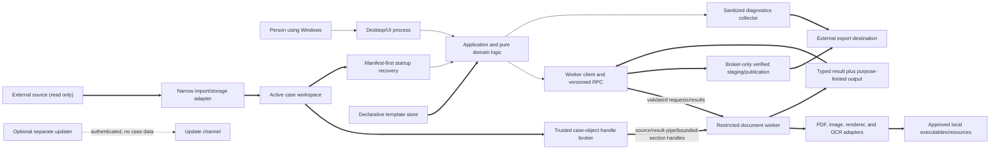
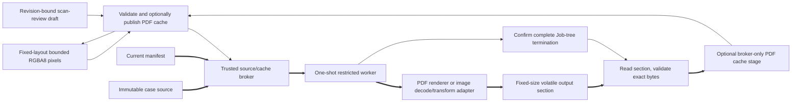
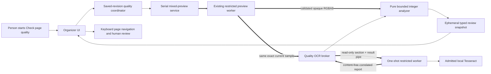
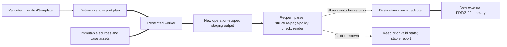
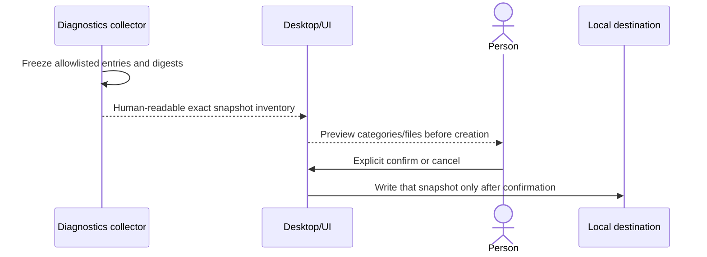

# PaperWorkShell data flows and trust-boundary crossings

- Status: Binding foundation model
- Task: PWS-0004
- Companion: [foundation threat model](threat-model.md)

## Reading the diagrams

Thin arrows carry control or typed metadata that is either validated or awaiting validation at the
receiving boundary. Thick arrows represent document-derived bytes that must never be written to
routine logs. Dashed arrows are optional future behavior.
The prose below every diagram is authoritative and provides an accessible text alternative.

Component labels describe ownership, not a promise that every component already exists. Future
tasks must preserve the trust-boundary rules rather than copying these labels into one process.

## System context



Text alternative: the person interacts only with the desktop process. Application/domain logic
orchestrates a validated worker client. Full document processing occurs in a restricted worker
through admitted adapters and local tools. External sources enter through a narrow read-only
import/storage path and become random case-scoped files before complex parsing. A trusted broker
must authenticate and transfer an exact least-privilege handle before a worker operation can touch
one of those objects; logical case binding is not path access. Verified output moves from case
staging to a user-selected external destination. Templates enter as validated data. Diagnostics
use a separate allowlisted flow. A future updater is separate from document processing and sends
no case data. The `protocol.noop` operation receives no document handles. PWS-0105's separate
one-shot `pdf.inspect` generation receives only one deliberately brokered
prepared-source read handle and one write-only result-pipe handle. PWS-0108 receives one committed
source reader and one fixed-size volatile section mapping; only the broker can write persistent
cache staging. PWS-0204's separate OCR-only generation receives one immutable-source reader, one
bounded volatile PDF-section writer, and one bounded report writer. It may start only the exact
Tesseract child; the broker exposes no OCR text or persistent/searchable derivative.
PWS-0207 serially reuses validated DF-PREVIEW snapshots and adds the narrower `ocr.review`
version-1 worker authority: one bounded read-only volatile raster section and one write-only result
pipe, with no document/source handle, case path, document object, or persistent writer. The
accepted desktop result remains an ephemeral typed finding snapshot.
PWS-0307 adds a distinct `pdf.export.flattened` version-1 generation. It receives one canonical
plan reader, exact immutable-PDF source readers, exact operation-scoped RGBA8 signature-raster
readers, one bounded volatile PDF writer, and one content-free result writer. It receives no
encoded signature image, case path, manifest/history writer, or external destination authority.

## Boundary inventory

| Boundary | Producer → consumer | Data crossing | Required check before consumption |
|---|---|---|---|
| TB-01 | Person/Windows shell → UI | Paths, typed values, drag/clipboard data, confirmation | Length/type/state validation; no trust from extension or familiar display |
| TB-02 | Application → worker | Versioned request, per-launch capability, internal IDs, logical case-object references, limits | Fresh AppContainer/job generation; explicit inherited pipes and fixed bootstrap grant; bind worker, case, operation, sequence, and request; schema/type/version/size/state validation; replay rejection |
| TB-02 | Worker → application | Progress, typed result, capability, stable error | Validate explicit transport/session binding, envelope, IDs, sequence/state transition, size, references, counts, and sanitized parameters |
| TB-03 | Trusted broker → worker | Exact opened read-only input, bounded result-pipe writer, or fixed-size volatile output-section handle | Authenticate object type, identity, case/operation scope, access, containment where applicable, size/digest/logical cap, and lifetime before transfer; no persistent cache writer; broker-only authoritative publication |
| TB-04 | Worker adapter → local tool/resource | Executable, arguments, input/output handles, controlled environment/search paths | Approved path/version/identity and exact runtime closure, fixed working directory, no shell or ambient search, bounded I/O/time/resources/descendants, worker-wide process audit, network denial |
| TB-05 | Import adapter → external source | One read-only handle and bounded byte stream | Classify local/device/network location before open; supported regular-file identity; never request write access |
| TB-06 | Verified staging → export destination | Exact verified PDF/ZIP/summary bytes, size/digest, and safe name | Classify destination; reject original/prior-output aliases; destination-local temporary file, collision policy, terminal identity/digest recheck, per-artifact atomic commit |
| TB-07 | Diagnostics → bundle destination | Frozen allowlisted entry snapshot and generated safe files | Preview and confirm the exact snapshot/digests; no recollection; prohibited-content scan; local write only |
| TB-08 | Template store → loader | Template bytes, provenance, and trust state | Size, schema, version, checksum/signature when supported, expiry; data only; inert provenance URLs are never dereferenced |
| TB-09 | Updater ↔ network/install | Version/channel metadata and package | No case fields; authenticated metadata/package; rollback/expiry/channel policy |
| TB-10 | Case storage → local account/session | Case files and lock/retention state | Restrictive permissions, random names, consent/lock/expiry policy |

## DF-WORKER-LIFECYCLE — launch, negotiate, operate, stop, and restart

```mermaid
sequenceDiagram
    participant App as Application coordinator
    participant Client as GUI-safe worker client
    participant Win as Trusted Windows launcher
    participant Host as Restricted worker host
    App->>Client: Start with logical case ID and trusted policies
    Client->>Win: Fresh session, worker ID, capability, resource policy
    Win->>Win: Recover ACL ledger; create profile, exact-object grants, pipes, and Job
    Win->>Host: Create suspended with exactly stdin/stdout/bootstrap handles
    Win->>Win: Assign job; write fixed 92-byte grant; resume
    Host->>Host: Validate grant and audit token/job/environment
    Client->>Host: Framed, authenticated session.hello
    Host-->>Client: Validated session.ready
    Client->>Win: Duplicate exact reduced source/result handles after ready
    Client->>Host: One registered operation and explicit limits
    Host-->>Client: Accepted, progress, and one terminal result
    Client->>Host: Optional cooperative cancel or graceful shutdown
    Host-->>Client: Cancel acknowledgement/result or session.closed
    Client->>Win: Timeout, fault, or force-stop terminates retained job tree
    Client->>Win: Restart creates a wholly fresh generation; no replay
```

1. TB-02 launch state is generated by the trusted client, not the worker: a new generation,
   session UUID, worker-instance UUID, case UUID binding, and 256-bit capability.
2. Before a new profile, the launcher authenticates its private versioned ACL-recovery journal
   under the protected Global mutex and repairs only dead/interrupted grants whose complete legacy
   v1 or exact-object v2 inventory still matches the current approved access roots. Invalid or
   unprovable state blocks launch. It then creates a zero-capability AppContainer, authenticates and
   retains the bounded runtime/code/fixed-tool object inventory, and durably records each v2 object
   identity, current-user peer SID, inheritance state, and per-file guard baseline before mutation.
   Overlapping live v2 leases share one hardlink guard per file; the profile receives only direct,
   non-inheritable read/execute entries on the exact recorded objects. The broker resolves a trusted
   logical `LocalAppData` Known Folder spelling and constructs `LOCALAPPDATA`, `TEMP`, and `TMP`
   beneath it; AppContainer maps those values once into the independently authenticated physical
   ephemeral profile. No user environment or case path is inherited.
3. The child is created suspended with a fixed absolute executable/argument array, no shell, and
   exactly three anonymous-pipe handles. The Job Object is configured/assigned before resume and
   covers memory, CPU, process-count, kill-on-close, and descendant termination policy.
4. Standard error is a one-shot bootstrap reader, not a diagnostic channel. The exact 92-byte
   grant carries only fixed magic/version, three UUID identities, and the capability. RPC on
   standard input/output is independently length-framed to 65,536 payload bytes.
5. The worker fails before `session.ready` unless the grant, AppContainer token, zero capabilities,
   Job membership, minimal environment, protocol binding, and negotiation validate. Malformed,
   replayed, cross-generation, or out-of-order messages fault the generation before dispatch.
6. One coordinator actor on each side owns protocol state. Progress/operation threads report
   bounded events only. A valid terminal result processed before a deadline event wins; a cancel
   acknowledgement is nonterminal. A timeout/fault terminates the complete job tree.
7. A clean shutdown requires correlated `session.closed`. Unexpected EOF/exit becomes a stable
   failure without killing the desktop process or exposing exit/stderr values. Restart creates new
   profile/job/pipes/IDs/capability/sequences and never replays work.
8. The no-op carries no inputs, outputs, or document handles. PWS-0105 adds the first narrow
   document operation only after ready: a trusted storage broker authenticates one sealed pending
   PDF and the Windows client duplicates reduced source-read and result-pipe-write handles into a
   fresh generation. This does not grant a case path or directory ACL.
9. Live evidence must cover real IPv4/IPv6 TCP/UDP denial for worker and descendant, whole-tree
   kill/no-breakaway, exact inherited handles, environment canary absence, path denial, deliberate
   handle success, and profile/grant cleanup. A required skip is not a pass.

Primary threats: TM-001, TM-002, TM-004, TM-008, TM-009, TM-011, TM-012, TM-022, TM-023.

## DF-PDF-INSPECTION — broker, inspect, correlate, and revoke

```mermaid
sequenceDiagram
    participant Store as Trusted source store
    participant Broker as PDF inspection broker
    participant Win as Windows worker client
    participant Host as Restricted worker
    participant PDF as pikepdf/libqpdf adapter
    Store-->>Broker: Sealed prepared summary and exact retained object
    Broker->>Store: Borrow independently positioned read handle
    Broker->>Broker: Create bounded anonymous result pipe
    Broker->>Win: Launch fresh isolated generation; wait for pdf.inspect
    Broker->>Win: Duplicate reduced source-read and result-write handles
    Broker->>Host: Authenticated reference, size/digest, handle values, limits
    Host->>Host: Copy and hash into worker-private temp; close case handle
    Host->>PDF: Inspect verified stream under limits/deadline/cancellation
    PDF-->>Host: Closed typed structural result or sanitized failure
    Host-->>Broker: Write correlated capped frame; close writer; terminal RPC
    Broker->>Win: Always terminate and confirm one-shot job tree
    Broker->>Broker: On RPC success, read EOF and validate frame/correlations
    Broker-->>Store: Release exact borrow and pipe authority
```

1. TB-03 begins only after PWS-0104 sealed and independently rehashed the random pending copy.
   Storage matches the complete summary and uses `ReOpenFile` on its retained object; it rechecks
   identity, size, regular/single-link/reparse/sparse state, and alternate streams without resolving
   a lexical path.
2. The ready worker receives source rights limited to read data/read attributes/synchronize and
   result-pipe rights limited to write data/synchronize. Both child handles are non-inheritable.
   The AppContainer SID receives no case ACL, and the source/result handle values are distinct
   worker-local parameters in the closed `pdf.inspect` codec.
3. The worker verifies the source's type/size, copies exactly the expected bytes into bounded
   AppContainer-private temporary storage while recomputing SHA-256, and closes the case handle
   before native parsing. A short, surplus, changed, or over-limit source fails without commit.
4. The pikepdf adapter opens without password guessing or recovery, applies page/object/graph/time/
   cancellation limits, scans all indirect objects for the registered markers, and uses embedded
   libqpdf syntax checking. It returns only closed states; raw warning, object, and exception values
   are discarded.
5. The result pipe carries one length-prefixed frame capped at 4,132 bytes and bound to both the
   operation UUID and prepared-source UUID. RPC success occurs only after the worker wrote and
   closed that frame; it does not make the frame trusted.
6. Success, failure, cancellation, deadline, invalid frame, or crash all end with whole-tree
   termination before the broker releases the exact source/pipe authorities. Only after successful
   RPC and confirmed termination does it read through EOF and validate the complete frame. It never
   remotely closes a worker handle number that Windows could have reused.
7. An opened unencrypted result can become complete import metadata after the trusted application
   binding checks. Encrypted or malformed state, a missing count, unknown required state, or any
   operation/report failure leaves the pending copy non-authoritative and the previous manifest
   unchanged. Signature state means structural markers only, not cryptographic validation.

The standalone qpdf command seam uses a fixed absolute executable and argv with `shell=False`, a
minimal environment, bounded discarded output, cancellation/timeout cleanup, and no PATH lookup.
It provides command-boundary evidence; the production handle-bound stream uses pikepdf's embedded
libqpdf. See the
[PDF structural-inspection contract](../architecture/pdf-structural-inspection.md).

Primary threats: TM-001, TM-002, TM-003, TM-004, TM-005, TM-008, TM-009, TM-011, TM-012, TM-016,
TM-022, TM-023, TM-025, TM-026.

## DF-IMPORT — select, precheck, copy, inspect, and commit source

```mermaid
sequenceDiagram
    actor Person
    participant UI as Desktop/UI
    participant Precheck as Source precheck
    participant Case as Case pending/originals
    participant Inspect as Typed inspection boundary
    participant Broker as Trusted storage broker
    participant Manifest as Manifest transaction
    Person->>UI: Select source path
    UI->>Precheck: Import request, selected path, limits
    Precheck->>Precheck: Canonicalize; open once read-only; bounded framing
    Precheck->>Case: Stream same live handle to random pending file; hash
    Case->>Case: Flush, reopen, verify size/digest/identity
    Precheck->>Precheck: Terminal external-source identity check; close lease
    Precheck-->>Broker: Prepared logical ID and verified byte facts
    Broker->>Inspect: Exact prepared-copy handle and explicit limits
    Inspect-->>Broker: Typed complete metadata or stable error
    Broker->>Case: Publish exact copy as random source ID
    Broker->>Manifest: Append source + complete pages/base/final sequence
    Manifest->>Manifest: Validate target; atomically replace manifest
    Manifest-->>UI: Committed source ID, duplicate advisory, concrete status
```

1. TB-01: the selected path and displayed extension are untrusted.
2. TB-05: the narrow adapter classifies local/device/network policy, rejects unsupported locations,
   and opens a supported regular source exactly once with read-only sharing/identity policy. It may
   perform only bounded signature/size checks while streaming that handle; it never parses full
   PDF/image structure in the UI process.
3. TB-03/TB-05: bytes stream from that same live handle into a random case-scoped pending name while
   SHA-256 is calculated. The pending file is flushed, reauthenticated, and independently read back
   for exact size/digest verification. It remains non-authoritative until the source context exits
   normally and its terminal identity check succeeds. A changing/truncated source, cancellation,
   limit, disk-full, or write failure leaves no valid source record.
4. TB-02/TB-03: complex inspection follows DF-PDF-INSPECTION or the bounded image-intake flow. It
   receives only a logical prepared reference, case/operation binding, explicit limits, an exact
   broker-authenticated read-only handle, and one purpose-limited bounded output authority. PDF
   returns typed structural metadata; JPEG/PNG must complete one full decode and correlated
   normalization before its provisional one-page facts are accepted. PDF `not_checked` values, a
   missing page count, or any incomplete image decode cannot be promoted into a source record. The
   one-shot worker ends before storage releases the borrow and cannot write the pending copy,
   manifest, journal, source records, or page records; raw third-party exceptions are discarded.
5. The trusted broker validates the complete metadata and serializes duplicate detection against
   committed SHA-256 values. A match is advisory: each accepted import retains a distinct random
   source ID, immutable case copy, display name, and page identity.
6. The broker first resolves any valid pending PWS-0109 checkpoint, then publishes the exact
   verified pending identity beneath `originals/` inside the shared per-case manifest transaction.
   The full candidate is schema- and semantic-validated, written to two authenticated stages, and
   recorded at `journal/latest.json` before `manifest.json` is replaced. Before operation history
   exists, import extends both base and final sequences. With history present, it preserves the
   base and appends a replayable `change_sequence` operation with reason `import`. A direct
   transaction refuses to displace a different recoverable next-revision checkpoint.
7. Cancellation or interruption before checkpoint publication retains the previous valid manifest
   and removes only the exact source still owned by the operation. Once a checkpoint is committed
   or its publication is uncertain, the random source and exact candidate are preserved until a
   fresh load settles recovery. Confirmed manifest commit wins over late cancellation. A
   post-source/pre-checkpoint process crash can still leave a random unreferenced case orphan for
   PWS-0113; it is not a source record. The external source is never opened for writing. Later
   read-only size, SHA-256, link, stream, reparse, and containment checks detect application-model
   mutation; they do not authenticate against malware able to rewrite both case files and manifests.

Primary threats: TM-001, TM-002, TM-003, TM-005, TM-006, TM-007, TM-011, TM-012, TM-022,
TM-023, TM-026.

## DF-PREVIEW — render bounded thumbnails/previews



1. The UI names internal case/page IDs, desired bounded dimensions, cancellation intent, and either
   canonical manifest transform intent or one validated PWS-0203 tentative scan-review intent; it
   never opens the source document. A review draft binds the exact case, page, manifest revision,
   authoritative base intent, candidate intent, suggestion state, and contract version. Original
   uses neutral source-relative intent; Adjusted uses the exact candidate. A multi-page request is
   scheduled serially as one bounded worker operation per page, while scan review is limited to one
   selected image page. Aggregate progress contains only phase and page counts.
2. TB-02/TB-03: before a cache hit, render, or image normalization, the trusted broker resolves the
   page through the current manifest and authenticates one exact committed PDF/JPEG/PNG handle, including file identity,
   containment, type, size, SHA-256, link/reparse/sparse/stream state, and retained lifetime. A
   cache key, path, case/page UUID, or existing filename alone never authorizes access.
3. For PDF, the versioned cache key covers internal case/source/page IDs, source index/size/SHA-256,
   dimensions/rotation, fixed RGBA8/white/CropBox/annotation choices, and renderer-profile digest.
   Final and staging names contain only random internal IDs and a full key digest. Source
   authentication precedes lookup, so cached state cannot conceal a changed source. Image previews
   do not publish a persistent raster cache: each miss is regenerated from the authenticated source
   and only the UI's byte-budgeted pixmap LRU is reusable. A transformed image result additionally
   binds the complete canonical operation bytes/digest, the normalized-source pixel digest, the
   eight-token transform engine profile, output bounds, and pixel-affecting dependency versions; a
   key never replaces source reauthentication. Tentative review results additionally require exact
   draft/generation correlation before Qt accepts them; a successful adjusted result becomes only a
   temporary Apply-eligibility token, never manifest authority. The upstream normalization-profile
   digest belongs to approved golden provenance rather than the volatile runtime cache-key contract.
4. On a PDF miss, storage reserves the worst-case artifact size against the case-cache quota and creates
   one random broker-only stage. The broker also creates an unnamed pagefile-backed section from
   the exact logical operation output limit; its volatile backing may be rounded by less than one
   memory page, while the adapter enforces the logical cap. It duplicates only source-read and
   section map-write rights into a fresh worker. The worker receives no persistent cache-file
   handle, case/cache path, directory, manifest, delete, rename, or publication authority.
5. The worker rehashes the exact source and renders a PDF page or fully decodes/transforms one
   JPEG/PNG under page/pixel/decompression/metadata/output/temp/memory/CPU/wall limits. Image
   transforms use the one fixed order: intrinsic EXIF orientation; crop in full logical
   pre-manifest-transform coordinates; accumulated quarter-turn; deskew; contrast; background
   cleanup; bounded fit/serialization. Alpha is composited on white.
   The operation writes a fixed binary header plus exact opaque raw RGBA8 payload. Success references
   exact operation/output IDs, artifact size, whole-artifact SHA-256, and content kind; other outcomes
   reference no output. The transform artifact also binds the exact operation/profile digest so a
   syntactically valid normalization result cannot satisfy a different transform request.
6. RPC success is untrusted. The broker first confirms complete one-shot Job-tree termination,
   then reads only the claimed bounded byte count through its read-only section view and validates
   RPC correlation, key/header versions, reserved fields, IDs, dimensions, stride, profile, exact
   lengths, digests, and opaque alpha. Only a validated PDF artifact may be written to its persistent
   broker stage; storage seals, reads back, validates again, and no-replace renames it. A validated
   image artifact goes directly to the bounded UI snapshot/LRU. The UI never decodes arbitrary
   worker-produced PNG/JPEG/PDF bytes or follows a raced cache path.
7. Cancellation, parser/transform fault, invalid output, or quota failure leaves the manifest
   unchanged. PWS-0203 preview, suggestion initialization, Reset, dialog Cancel, and stale or late
   results likewise queue no history/autosave mutation. Apply separately revalidates the bound
   case/page/revision/base/history and the exact successful candidate. Changed intent builds every
   command locally and queues one final candidate only after complete validation; exact no-change
   intent completes with unchanged history and no autosave candidate.
   Before validation, the only worker-writable output is volatile and OS-capped; any PDF persistent
   stage remains empty and broker-only. Unconfirmed worker termination therefore cannot leave a live
   persistent writer. Only an indeterminate PDF-cache publication state quarantines a random stage;
   earlier complete page entries remain safely reusable.
8. Paths, filenames, source/cache/pixel/intent digests, text, metadata, rendered bytes, thumbnails,
   raw RPC, handles, and third-party exceptions never enter routine logs or scan-review
   accessibility metadata. Fixed pixels reach only the requested UI snapshot after complete
   validation. Original and Adjusted expose only their role and textual presentation state; they do
   not receive content-derived descriptions.

The complete implementation contracts are the
[bounded PDF-thumbnail service](../architecture/pdf-thumbnails.md) and
[bounded JPEG/PNG intake](../architecture/image-intake.md), extended by the
[non-destructive scan-transform pipeline](../architecture/image-transform-pipeline.md) and the
[before-and-after scan-review UI](../architecture/scan-review-ui.md).

Primary threats: TM-001, TM-002, TM-003, TM-006, TM-011, TM-012, TM-022, TM-023.

## DF-QUALITY-REVIEW — derive ephemeral advisory findings



1. The user explicitly starts the review. The organizer accepts only one exact saved case revision
   with the complete current ordered page tuple and current PDF/image presentation intent. Pending
   autosave, a stale expectation, case switch, or changed history rejects or invalidates the
   request. The UI prevents a request when there are no active pages; the lower application model
   still represents an exact empty snapshot without preview work. Starting or displaying a review
   writes no manifest, journal, page history, checklist, confirmation, diagnostic, or export state.
2. Preview production serially reuses DF-PREVIEW. A PDF contributes one current-rotation preview
   bounded to 256 by 256 pixels. A JPEG/PNG contributes one 1-by-1 metadata result for validated
   encoded dimensions, which is released before one current-intent preview bounded to 256 by 256
   pixels. Complex source parsing and decoding remain in the restricted preview worker. This reuse
   may populate DF-PREVIEW's existing bounded disposable cache; PWS-0207 adds no new
   quality-specific cache or persistence surface.
3. The application/domain boundary validates exact request/result correlation and opaque RGBA8
   layout before simple integer analysis. Page processing is serial and releases page-scoped
   sample/luminance state before the next preview. OCR review may create bounded transient copies
   of that current sample in the broker section and worker, so “one page at a time” is not a
   single-physical-buffer claim. One private 64-bit difference hash plus two bounded integer ratios
   is retained for each earlier page only during this call. No sample, thumbnail, fingerprint, or
   pixel/source digest enters the finding result or routine presentation; the non-content profile
   configuration SHA-256 is carried for reproducibility.
4. The `scan-quality-v1` profile uses integer thresholds and canonical configuration identity.
   The exact configuration SHA-256 in each snapshot identifies profile settings, not document
   content or executable code. Low-source-resolution applies only when an image result provides
   validated encoded pixel dimensions; a PDF thumbnail cannot establish embedded-raster
   resolution. Sideways projection may suggest 90/270-degree line-like content but cannot reliably
   detect 180-degree rotation. These and every exact threshold are documented in the
   [advisory quality-review contract](../architecture/quality-review.md).
5. Duplicate comparison walks prior pages in active manifest order, keeps at most one duplicate
   suggestion for the later page, stops at the earliest match, and checks cancellation at least
   every 32 comparisons. The 4,096-page model cap, selected policy's stricter live limit (currently
   1,000 pages), and one 3,600-second whole-review deadline bound the otherwise quadratic worst
   case. The existing selected `ResourcePolicy`, one-heavy-operation gate, worker limits, cache
   accounting/low-disk behavior, and network denial remain authoritative for preview production.
6. PWS-0207's separate additive `ocr.review` version-1 producer does not change `ocr.process`.
   Backend startup performs no optional OCR admission. With an authenticated available selected
   session language set, the first explicit quality review constructs/adopts the capability-scoped
   composition on the backend owner thread after cancellation/deadline checks. This local
   inventory/admission work is bounded in scope but has no elapsed-time guarantee; the coordinator
   checks cancellation/deadline again immediately afterward. Composition authority is reused, but
   every page starts and terminates a fresh AppContainer/Job worker before report consumption.
   The worker receives no protocol input objects or source handle: only an at-most-256-by-256 RGBA8
   read-only pagefile section, a result-pipe writer, closed page/revision/layout/digest/language/
   profile parameters, and one-page resource limits. It writes one private bounded PPM, performs
   fixed `--version`/`--list-langs` admission probes and one recognition invocation with `--psm 6`,
   and captures TSV on stdout while separately discarding stderr under one shared 1 MiB byte cap.
   It parses only bounded numeric confidence/count facts, discards word bytes and geometry, removes
   the PPM or fails on cleanup uncertainty, and returns an object-free canonical report bound to
   operation, case, revision, page,
   sample/presentation digests, selected language/profile, status, count, confidence, and engine
   version. The broker terminates the whole worker tree before reading and authenticating that
   report. Expected local engine/runtime absence, an unavailable language, or an engine-reported
   recognition failure maps to a `failed` fact without claiming inspection. Only the expected
   unavailable lazy-admission state is session-latched; restart creates a fresh authority/admission
   attempt instead of retrying expensive work for every page. Authority, isolation, launch,
   process, transport, protocol, resource-limit, cleanup, and malformed-result failures abort the
   review and publish no snapshot. No TSV file, OCR text, page image, report, or finding is
   intentionally or authoritatively persisted.
7. Findings use closed codes, evidence kinds, bounded integers, fixed titles/remediation messages,
   and **Likely**, **Suspected**, or **Needs review** qualifiers. They cannot apply edits, remove a
   page, complete a requirement, or certify quality. A no-signal result means only that the limited
   configured checks did not cross a threshold.
8. The snapshot is accepted only after exact operation, generation, case, revision, page-order,
   profile, and unchanged backend/UI-state validation. Cancellation, timeout, malformed output, or
   stale state exposes no partial snapshot. A state change clears an accepted snapshot; saving a
   new process-session OCR language selection specifically clears its findings and returns quality
   state to `not checked`. The UI may queue exactly one quality request behind cancellation of an
   ordinary preview and resumes normal previews after the quality operation drains. Worker
   capacity/low-space refusal publishes no report or partial snapshot; private cleanup completes
   and a fresh review can retry.
9. Routine errors, progress, logs, and accessibility metadata contain only closed codes, internal
   IDs, phases, counts, safe static wording, and permitted profile identity. They exclude pixels,
   thumbnails, fingerprints, OCR/document text, filenames, full paths, metadata, digests, and raw
   exceptions. The keyboard-accessible virtual findings list navigates to a page for human review;
   it has no Resolve, Apply, or Mark complete action.

Primary threats: TM-001, TM-002, TM-003, TM-004, TM-008, TM-009, TM-011, TM-012,
TM-022, TM-023, TM-024, TM-028.

## DF-OCR — local cleanup and recognition

```mermaid
sequenceDiagram
    participant App as Trusted broker/application
    participant Worker as Restricted worker
    participant OCR as OCRmyPDF 17.10.0 adapter
    participant Tool as Tesseract 5.5.3 child
    participant Temp as AppContainer-private temp
    participant Volatile as Broker-owned bounded section
    App->>Worker: Source-read, section-write, report-write handles and closed request
    Worker->>Temp: Copy and rehash immutable source; close case handle
    Worker->>OCR: Fixed profile, private paths, limits, cancellation/progress seams
    OCR->>Tool: Approved absolute executable and fixed argument array
    Tool-->>OCR: Bounded/discarded status and private generated files
    OCR->>Temp: Standard PDF candidate; reopen, page-count, size and SHA-256 check
    Worker->>Volatile: Copy exact candidate bytes
    Worker-->>App: Content-free progress, correlated reference and report
    App->>Worker: Terminate and confirm complete Job tree
    App->>App: Revalidate source, report, profile, section size and SHA-256
```

1. TB-02 accepts only a version-1 `ocr.process` request bound to internal case/source/operation IDs,
   a content-derived source kind, exact source size/page count/SHA-256, the fixed language/profile
   tokens, explicit resource limits, and cancellation. A language token resolves only through the
   closed `eng`, `deu`, or `eng`-then-`deu` set definitions; it is never an argument fragment. No
   source path, filename, OCR text, manifest content, or executable value appears in RPC.
2. TB-03 separately authenticates a retained immutable PDF/JPEG/PNG source lease and transfers
   only three distinct reduced handles: source read, bounded volatile-section write, and bounded
   report-pipe write. The worker has no case ACL/path, source-write, manifest/journal/history,
   persistent cache/stage, or external-destination authority. It copies and rehashes the exact
   source in private temp and closes the case handle before native processing.
3. A PDF request proceeds only when upstream inspection reports confirmed unencrypted state and no
   signature markers. Marker-present, unknown-signature, encrypted, and unknown-encryption states
   fail before worker launch. This is a conservative fail-closed gate, not cryptographic signature
   validation; PWS-0208 owns an explicit derivative-warning/confirmation workflow.
4. TB-04 admits only OCRmyPDF `17.10.0`, Tesseract `5.5.3`, the built-in `eng` model, an optional
   exact `deu` model, and the fixed profile digest:
   `image_dpi=300`, standard PDF, `mode="skip"`, pypdfium rasterization, fpdf2 text rendering,
   `optimize=0`, `jobs=1`, and disabled OCRmyPDF cleanup transforms. The packaged Tesseract
   manifest authenticates the exact 39-file base closure. A separate fingerprinted catalog admits
   only the exact-size, exact-SHA-256 `deu.traineddata` file. Missing optional data is unavailable;
   changed, hardlinked, special, reparse, offline/recall, alternate-stream, or unlisted resources
   invalidate admission before launch. Both runtime paths pass closed lexical/layout checks before
   native queries, then must resolve through one mount-manager-registered `DRIVE_FIXED` NTFS/ReFS
   volume with persistent ACLs whose drive and volume-GUID names map to the same
   `\\Device\\HarddiskVolumeN`. UNC/device spellings, network-drive mappings, unregistered DOS
   aliases, and provider mappings that do not meet that OS-visible contract fail before runtime
   enumeration or hashing. This does not attest physical medium or lower-layer storage transport;
   iSCSI-, SAN-, or VHD/VHDX-backed volumes can satisfy the checks.
5. The only OCR child starts with the approved absolute executable, fixed working directory,
   structured arguments, `shell=False`, no `PATH`/`PATHEXT`/`COMSPEC`, and a minimal private
   environment. A worker-wide process audit hook rejects any other process-creation shape.
   Worker and child remain in one zero-capability, no-breakaway Job with a two-process limit, egress
   denial, CPU/memory/wall limits, and complete-tree termination.
6. OCRmyPDF, Tesseract, Python temporary files, and the candidate stay under one pinned random
   AppContainer-private operation root. Capacity is checked prospectively against the complete
   operation temp limit plus safety reserve; a concurrent no-follow monitor and stage-boundary
   inventories enforce bytes, entry type, and reparse rules. A prospective capacity shortfall
   fails before staging, while a later disk-full write removes its partial private tree and permits
   a fresh retry. Cleanup uncertainty is failure. No
   OCR partial is written to case temp/cache or treated as authoritative.
7. Progress contains only a closed phase and bounded monotonic page counts. Cancellation/deadline
   checkpoints cover source copy, OCR progress, child wait/termination, temp monitoring, candidate
   copy, and broker validation. Success, cancel, timeout, engine/language absence, malformed
   request/report/output, process crash, source race, and resource fault all terminate the complete
   one-shot Job before report/section readback or source-authority release.
8. The worker first requires a private regular `%PDF-` file within output size, SHA-256, and expected
   page-count bounds after a no-recovery, unencrypted pikepdf reopen through the narrow PDF seam.
   After confirmed Job termination, the broker reauthenticates the
   immutable source, validates every report/request/profile/version/output correlation, and hashes
   the exact section bytes independently. Only then does it expose a single-pass, broker-owned
   volatile PDF candidate. PWS-0204 exposes neither OCR text nor a final searchable export.
   PWS-0206 separately reuses the admitted adapter/profile inside its own worker operation; it does
   not route this broker-owned candidate across operations.
9. Tool output, OCR/document text, filenames, full paths, digests, metadata, candidate bytes, and
   third-party exceptions never enter routine logs, progress, representations, or UI errors.
   Later confidence/quality signals must say “Needs review” and cannot satisfy a checklist item.

The complete implementation contract is the
[bounded local OCR worker](../architecture/ocr-worker.md).

Primary threats: TM-001, TM-002, TM-003, TM-004, TM-005, TM-006, TM-008, TM-009, TM-011, TM-012,
TM-016, TM-020, TM-022, TM-023, TM-024.

## DF-SEARCHABLE — per-page mixed composition and verification

```mermaid
sequenceDiagram
    participant User
    participant UI as Unsigned-derivative confirmation
    participant App as Trusted searchable-export coordinator
    participant Gate as Signed-source policy gate
    participant Worker as Restricted one-shot worker
    participant OCR as Admitted local OCR adapter
    participant PDF as pikepdf/qpdf/PDFium adapters
    participant Status as Bounded page-status section
    participant Destination as Trusted no-replace destination
    App->>Gate: Validate structural state and source-scoped confirmation
    alt Marker present or marker state unknown
        Gate-->>UI: Reason-aware unsigned-derivative notice
        alt Cancel or Escape
            User->>UI: Cancel
            UI-->>App: Rejected; no operation authority
        else Explicitly continue
            User->>UI: Create unsigned derivative
            UI-->>Gate: Explicit presentation result
            Gate-->>App: Validated source-scoped confirmation
        end
    end
    App->>Worker: Admitted plan/source readers, PDF/status writers, report writer
    Worker->>PDF: Inspect page eligibility without returning text
    alt Existing supported text and no pixel transform
        PDF->>PDF: Copy born-digital page without rasterizing
    else Eligible image or transformed page
        Worker->>OCR: Process one private one-page base PDF
        OCR-->>Worker: Private bounded page result
    else Signature marker present or state unknown
        PDF->>PDF: Retain visual page; block OCR modification
    end
    Worker->>PDF: Reopen, qpdf-check, render-compare, inspect output text presence
    Worker->>Status: Exact closed outcome for each output page
    Worker-->>App: Correlated PDF/status references and content-free report
    App->>Worker: Terminate and confirm complete Job tree
    App->>App: Reauthenticate sources and validate every bounded result
    App->>Destination: Publish only the verified candidate under base export rules
```

1. TB-02 accepts only the additive version-1 `pdf.export.searchable` capability. Its request binds
   a bounded semantic plan, one exact authenticated PDF/JPEG/PNG source reference per source, a
   PDF output section, a separately bounded page-status section, a result pipe, and the selected
   resource limits. It does not reinterpret the `ocr.process` v1 or `pdf.export` v1 wire contracts.
2. The plan is a transient projection of one authenticated manifest-v2 snapshot. It binds source
   size/digest/page/signature/encryption facts, output page order, supported transform intent,
   and exact OCR/eligibility/text-presence/base-export profiles. It grants no
   manifest, history, case-directory, cache, destination, or persistent-stage authority.
3. Under `mixed-page-ocr-eligibility-v1`, a born-digital PDF page with supported extractable text
   and no pixel-transform intent stays on the page-copy path. An image source, signature-clear
   image-only PDF page, or signature-clear pixel-transformed PDF page may invoke the same admitted
   OCRmyPDF/Tesseract adapter and profile on one private base page. This does not invoke the
   `ocr.process` RPC. A marker-present or unknown-signature PDF is never OCR/pixel-modified; its
   visual page is retained with a page-local blocked outcome.
4. OCR engine success is not a text claim. The page result must first visibly match its base. The
   worker then strictly reopens the complete mixed output,
   runs the admitted qpdf structural check, PDFium-renders and compares every page, and applies
   `pdfium-non-whitespace-text-v1` to each output page. Extracted strings are discarded worker-side;
   only page IDs/indices, closed eligibility/outcome/failure codes, booleans, versions, and counts
   enter the status/report structures.
5. The exact page-local recognition failure, or absence of verified output text after OCR returns,
   retains the visual page and yields one exact “Needs review” outcome. Security, resource,
   cancellation, timeout, malformed-result, and cleanup failures remain authoritative operation
   failures. A review outcome cannot be counted as extractable text or converted into a whole-
   document searchable claim. A plan involving marker-present or unknown-signature input requires
   the **unsigned derivative** label and PWS-0208's explicit **Create unsigned derivative** choice.
   The reason-aware presentation distinguishes detected markers from an unknown marker state and
   keeps Cancel as the safe default. The presentation result is not authority by itself; the
   trusted gate validates the source-scoped confirmation before any worker operation is created.
   Cancel or Escape launches no worker and creates no destination. Confirmation does not permit an
   OCR or pixel transform that the signature-state policy blocks.
6. At most one full-resolution raster and one private page-local OCR result are live at a time
   under the constrained profile. Page-result/status/output/temp/destination capacities are checked before or
   during work. Low-disk, disk-full, cancellation, timeout, malformed result, source race, native
   failure, and cleanup uncertainty expose no verified output, release authenticated disposable state,
   and preserve source hashes, manifest/history schemas, and prior derivatives.
7. After confirmed complete-tree termination, the broker reauthenticates every source and validates
   object IDs, content kinds, capacities, byte counts/digests, page order, semantic fingerprint,
   and the complete base/page verification report. Publication then reuses the existing no-replace
   destination, final-name reopen, and export-history-v1 lifecycle without storing OCR text or
   changing released schema meaning.

The complete contract and deterministic fixture provenance are in
[Verified searchable mixed-document output](../architecture/searchable-mixed-output.md).

Primary threats: TM-001, TM-002, TM-003, TM-005, TM-006, TM-008, TM-011, TM-012, TM-014, TM-016,
TM-022, TM-023, TM-024, TM-028.

## DF-FLATTENED-OVERLAYS — compose ordinary page content and verify

```mermaid
sequenceDiagram
    participant App as Trusted flattened-export coordinator
    participant Assets as Committed signature-asset rasterizer
    participant Broker as Trusted handle broker
    participant Worker as Restricted one-shot worker
    participant PDF as Overlay/pikepdf/qpdf/PDFium adapters
    participant Destination as No-replace destination
    App->>App: Project visible overlays and enforce signed-source consent
    App->>Assets: Decode each required committed asset sequentially
    Assets-->>App: Authenticated bounded RGBA8 raster
    App->>Broker: Exact plan, source lease, raster map, and limits
    Broker->>Worker: Plan/source/raster readers plus output/report writers
    Worker->>PDF: Stage and rehash sources; render one overlay page at a time
    PDF->>PDF: Import explicit Form; materialize crop/rotation without generated interaction dependency
    PDF->>PDF: Strict reopen, graph/placement/font checks, qpdf, every-page PDFium render
    PDF-->>Worker: Content-free verified report and candidate facts
    Worker-->>Broker: Correlated report plus bounded volatile PDF
    Broker->>Worker: Terminate and confirm complete Job tree
    Broker->>Broker: Revalidate sources, report, size, digest, and candidate bytes
    Broker-->>App: Authenticated single-pass candidate
    App->>Destination: Publish new derivative only after verification
```

1. TB-02 accepts only additive `pdf.export.flattened` version 1. Neither `pdf.export` version 1 nor
   the manifest/export-history schemas change meaning. The canonical plan binds page order,
   effective crop/rotation, visible overlay intent, exact RGBA metadata, and the base export
   profile. Every UUID namespace and transferred authority is distinct and current-generation.
2. Placed-signature JPEG/PNG bytes are authenticated and decoded through the existing image worker
   before flattened-export authority exists. The flattened worker receives only exact, read-only,
   operation-scoped RGBA8 sections. Aggregate retained raster bytes and pixels derive from the
   central `ResourcePolicy`; assets are decoded sequentially, every result is rebound to the exact
   requested dimensions and RGBA layout, and no unbounded raster cache exists. The metadata-only
   plan also proves the plan-plus-sources-plus-rasters total fits the 256-reference RPC ceiling
   before decode, authority allocation, or launch; the broker independently rechecks it.
3. The broker transfers no path. Source PDFs are copied and rehashed in worker-private temporary
   storage; raster sections are mapped read-only and authenticated before rendering. The worker
   imports each verified overlay page as an explicit Form XObject, materializes crop and rotation,
   and the generated overlay graph creates no annotation, widget, AcroForm, action, script, XFA,
   attachment, or viewer-generated appearance dependency. The base export copies and binds
   page-local source content/resources and stored annotation appearances, but it does not certify
   catalog-dependent widget, action, named-destination, or similar behavior. Page-reachable
   optional-content dependencies are rejected because their Catalog visibility policy is not
   copied. PWS-0105/preflight reports source features and PWS-0405/PWS-0501 own later policy.
4. The adapter reserves every bounded page-reachable content-stream `Do` name before adding its
   resource. Direct source content must have balanced graphics/text/marked-content/compatibility
   scopes, and its ordered decoded middle streams are fingerprinted across save. The adapter then
   strictly reopens the candidate and verifies exact Form names, matrices, boxes, invocation counts,
   the unchanged middle streams, a canonical full generated-Form-graph fingerprint, embedded-font
   resources, signature-image facts, and prohibited interactive keys in that generated graph. The
   trusted overlay page and an actual-imported-Form harness must produce identical independently
   authenticated white/black PDFium rasters. Opaque vector/text paint keeps a mandatory region hit;
   partial-alpha eligibility is limited to full-bbox dense rectangle fills and signature windows
   whose every contributing alpha sample is at least two. Other sparse, faint, or subpixel paint
   keeps the exact graph and full-raster differential proof without a false fixed-resolution
   rejection. Valid empty or fully transparent no-paint intent is handled explicitly rather than
   inferred from operator presence.
   It then runs the fixed qpdf check
   and renders every final page with PDFium. Missing, blanked, clipped-away, or grossly displaced
   Forms, changed nested resources/source content, malformed output, unknown required state, output
   overflow, or renderer failure blocks the report and candidate.
5. Cancellation, timeout, source/asset race, disk-full, mapping failure, protocol fault, and cleanup
   uncertainty terminate the generation and expose no authoritative candidate. Only after complete
   Job-tree termination does the broker reauthenticate sources and the bounded output/report.
   Publication then reuses the established no-replace destination and history settlement path.

The full contract and reader-evidence boundary are documented in
[Verified flattened visual-overlay export](../architecture/flattened-overlay-export.md).

Primary threats: TM-001, TM-002, TM-003, TM-005, TM-006, TM-008, TM-009, TM-011, TM-012, TM-014,
TM-015, TM-016, TM-020, TM-022, TM-023, TM-025.

## DF-EXPORT — plan, build, reopen, verify, and commit derivative



1. Validated manifest/template state becomes a deterministic plan containing internal IDs, page
   order, transforms, overlays, constraints, output names, and verification profile. Before an
   export capability is granted, the trusted broker verifies the identity and recorded digest of
   every immutable source snapshot; changed or unknown state blocks export.
2. TB-02/TB-03: the trusted broker authenticates and transfers exact immutable-input and new
   operation-staging handles. The worker has no case-directory or destination path authority and
   cannot publish manifests, journals, export history, or external files. Signed-source policy is
   checked before any modifying operation; detection may be unknown and is not cryptographic
   validation. Marker-present or unknown state must pass the source-scoped explicit unsigned-
   derivative confirmation gate before the broker creates operation authority; Cancel or Escape
   therefore creates no worker generation, operation, staging output, or destination artifact.
3. The temporary result is reopened. Required parse, structural, page-count, encryption,
   attachment/interactive policy, naming/size, and render checks must pass. Unknown required state
   is failure.
4. TB-06: the trusted commit adapter alone copies the exact verified staging snapshot to a
   destination-local random temporary file, verifies size/digest and opened-file identity, then
   atomically commits the new derivative name. Imported originals, case inputs, hardlink/file-ID
   aliases, and previous verified outputs are never overwrite targets; filenames/ZIP entries are
   normalized and collisions are deterministic. Unsupported UNC/network-backed destinations fail
   before open until an owning task proves their semantics.
5. The single-PDF PWS-0112 path stores one path-free export-history-v1 receipt in a protected case
   journal as `PREPARED`; a matching `COMMITTED` marker becomes replayable only after exact
   destination publication and reopen. A known non-commit removes the preparation. An unknown
   post-rename state preserves it as commit-ambiguous. PWS-0407 does not reinterpret that
   single-PDF schema for a multi-artifact or ZIP package; its aggregate report is transient until a
   future versioned package-history decision defines exact member and partial-set semantics.
6. Destination denial, race, disk-full, partial multi-file write, or final recheck failure cannot
   produce a package success report. Commits are atomic per artifact, not assumed group-atomic;
   any partial set is inventoried for retry/cleanup and never replaces a prior package. The output
   report states concrete checks, not universal portal or legal validity.
7. On restart, single-PDF `COMMITTED` receipts may replay only the exact idempotent case-history append and
   manifest link. `PREPARED` receipts remain inert unless the exact downstream case record or
   manifest reference independently proves the same commit. Recovery never starts the worker,
   rebuilds an output, or accesses the destination. Invalid receipt state blocks replay and keeps
   parseable IDs reserved. No package-level restart recovery is claimed by PWS-0407.
8. A modified marker-present or unknown-signature source produces an explicitly unsigned
   derivative. This is a conservative output label, not a signature-validity claim. Permanent-
   redaction output remains unavailable until PWS-0608.

Primary threats: TM-005, TM-006, TM-014, TM-015, TM-016, TM-017, TM-022, TM-023, TM-025, TM-026,
TM-027.

## DF-DIAGNOSTICS — collect, preview, confirm, and write locally



1. PWS-0113 routine diagnostics accept only closed typed records: UTC timestamps, internal IDs,
   numeric engine/schema/protocol versions, closed events/outcomes/operation kinds, numeric
   counts/resources, and generic codes. There is no free-form message, context mapping, path, or
   exception field.
2. The PWS-0113 schema and summary reject OCR/document text, form values, names, addresses, original filenames,
   full paths, metadata values, thumbnails, signatures, and source/derivative bytes.
3. PWS-0113 provides bounded canonical JSON lines and a deterministic human-readable safe summary;
   it does not write a support bundle. PWS-0805 owns the following opt-in bundle steps.
4. TB-07 freezes an immutable allowlisted entry manifest (and entry digests where applicable),
   shows that exact snapshot in human-readable form, and binds explicit opt-in to its identity.
   Bundle creation writes only the approved snapshot and never recollects mutable diagnostics.
   There is no implicit upload, email, or network action.
5. A changed/missing snapshot, cancel, permission failure, disk-full, or partial write leaves the
   case unchanged and reports a sanitized failure. Generated test bundles are checked against the
   approved entry manifest and scanned for prohibited canaries.

Primary threats: TM-011, TM-018, TM-022, TM-026, TM-028.

## DF-RECOVERY — restore authority, settle receipts, and clean exact case artifacts

```mermaid
sequenceDiagram
    participant Startup as Trusted startup coordinator
    participant Manifest as Manifest repository
    participant Retry as Export retry/history boundary
    participant Case as Authenticated case workspace
    participant Diagnostics as Sanitized diagnostics sink
    Startup->>Manifest: Load current case; promote only a valid checkpoint
    Manifest-->>Startup: Exact snapshot or path-free unavailable issue
    Startup->>Retry: Inventory and settle exact durable receipts
    Retry-->>Startup: Repaired, pending, ambiguous, invalid counts
    Startup->>Case: Pin case; revalidate manifest identity/digest/CAS
    Startup->>Case: Remove exact unreferenced random source objects
    Startup->>Case: Remove stale thumbnail stages, then disposable temp
    Startup-->>Diagnostics: Closed events and aggregate numeric facts
```

1. Enumeration is bounded and accepts only canonical internal case UUIDs. An invalid,
   future-version, mismatched, or unrecoverable manifest makes that case unavailable and leaves its
   artifacts unchanged.
2. A valid manifest is authoritative. Export receipt settlement runs after manifest recovery but
   before generic temp cleanup. A `COMMITTED` receipt invokes only idempotent history append and
   manifest CAS linking. A `PREPARED` receipt without exact downstream proof remains ambiguous and
   is never treated as destination failure or success.
3. Cleanup is authorized under one authenticated case root and transaction guard. The exact
   manifest identity, SHA-256, and CAS token are rechecked before deleting only canonical random
   source objects absent from that snapshot. Stale thumbnail stages and case temp are removed by
   their owning bounded adapters. Unexpected names, aliases, links, streams, identity changes, and
   partial failures stay retained and become closed attention codes.
4. A concurrent manifest change causes one reload/retry and then an attention result; cleanup does
   not continue from a stale plan. No operation crosses into a sibling case, external original,
   previous export, or destination.
5. The case scan never reconnects to or replays a worker generation. A fresh worker launch remains
   subject to the separate Job/AppContainer lifecycle and must complete any authenticated
   persistent runtime/code ACL repair before granting a new SID. Case paths and case ACLs are not
   part of that repair boundary.
6. Recovery results and events contain only internal IDs, revisions, closed status/issue codes,
   counts, and numeric released bytes. Cleanup is not described as forensic erasure, and diagnostic
   success is not a document-content validation claim.

Primary threats: TM-006, TM-011, TM-012, TM-018, TM-019, TM-022, TM-023, TM-026, TM-028.

## DF-DELETE — inventory, close, scope, delete, and report


1. PWS-0102 accepts only an internal UUID and the exact application-storage removal confirmation.
   Its result states that forensic erasure is not guaranteed. The accessible inventory review,
   export explanation, and assisted-retention presentation remain owned by PWS-0706/PWS-0111.
2. The PWS-0102 application service rejects its active case, and the storage boundary rejects any
   retained lifecycle lease or quota reservation before mutation. Future document-worker
   composition must cancel/terminate active operations and close their handles before releasing
   that lease.
3. A trusted storage broker—not the document worker—resolves the internal ID beneath the configured
   case root and validates exact opened-file identity, containment, permissions, and
   reparse/symlink/hardlink behavior. Display names and user-provided paths never determine the
   deletion target.
4. The broker validates the supported matching manifest and inventories the complete fixed case
   tree before the first removal. It invalidates `manifest.json` first, then removes the verified
   inventory deepest-first and the exact root last. Deletion cannot cross the one case root. A
   post-invalidation failure returns sanitized partial counts rather than success; PWS-0113 owns
   restart cleanup/retry discovery. Deleted bytes are not promised recoverable, and unrelated
   cases/external exports are not deleted.
5. Assisted-use retention, expiry, automatic lock, and delete-after-verified-export remain gated
   by PWS-0705 and PWS-0706.

Primary threats: TM-006, TM-012, TM-013, TM-019, TM-023.

## DF-TEMPLATE — load declarative guidance

1. TB-08 accepts bounded local bytes and visible provenance/checksum/signature/trust state where
   supported. Schema validity alone does not authenticate a template or prove its guidance is
   suitable.
2. A data-only loader rejects path escapes, duplicate/unknown fields, invalid/future versions,
   unsafe/tampered provenance, expiry violations, expressions, imports, commands, scripts, and
   network/file dereference behavior. A schema-permitted provenance URL remains inert data and is
   never fetched by the template loader.
3. Valid template data can describe packaging requirements, constraints, warnings, and review
   confirmations. It cannot decide eligibility or silently mark substantive requirements complete.
4. Failure leaves the case unchanged and presents a plain remediation without raw template values
   in logs.

Primary threats: TM-010, TM-022, TM-023, TM-024, TM-025.

## DF-UPDATE — optional authenticated application update

This is a future M8 boundary, not a current runtime feature.

1. The updater is a separate component from the document worker. Core processing remains usable
   offline and the worker retains network denial.
2. TB-09 sends only approved application/channel/version information—never case IDs, paths,
   document hashes/content, template values, or diagnostics.
3. Update metadata and packages are authenticated before installation; channel, version, expiry,
   and rollback policy are checked before mutation.
4. Tamper, wrong channel, expiry, prohibited rollback, offline state, or interruption preserves the
   previous working version or an explicit recovery path.
5. Release tasks compare installed artifacts with the pinned inventory, licenses, hashes,
   signatures, and SBOM.

Primary threats: TM-004, TM-020, TM-021, TM-022.

## Failure-state invariant

For every flow, cancellation, timeout, process fault, invalid input/result, permission denial,
disk-full, and failed verification must converge on the same invariant:

- external originals and prior verified exports are unchanged;
- the last valid manifest remains authoritative;
- partial data is case-scoped, clearly non-authoritative, accurately inventoried, and available
  for safe retry/cleanup or recovery where possible;
- routine diagnostics contain only allowed fields and stable codes; and
- the UI offers a plain recovery action without requiring document-internal expertise.
